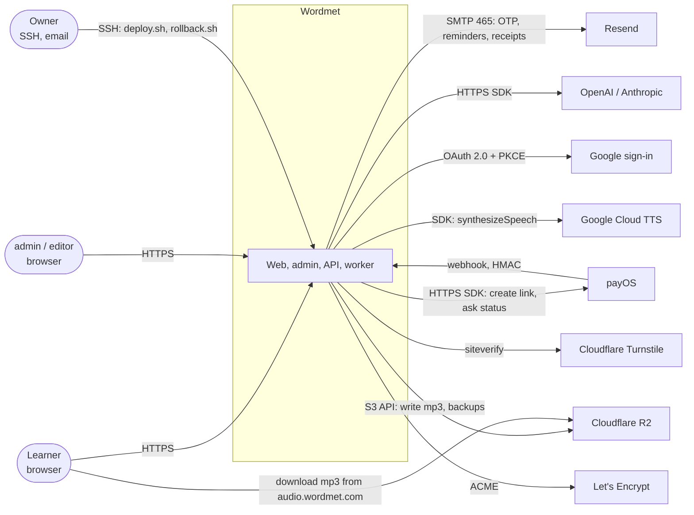
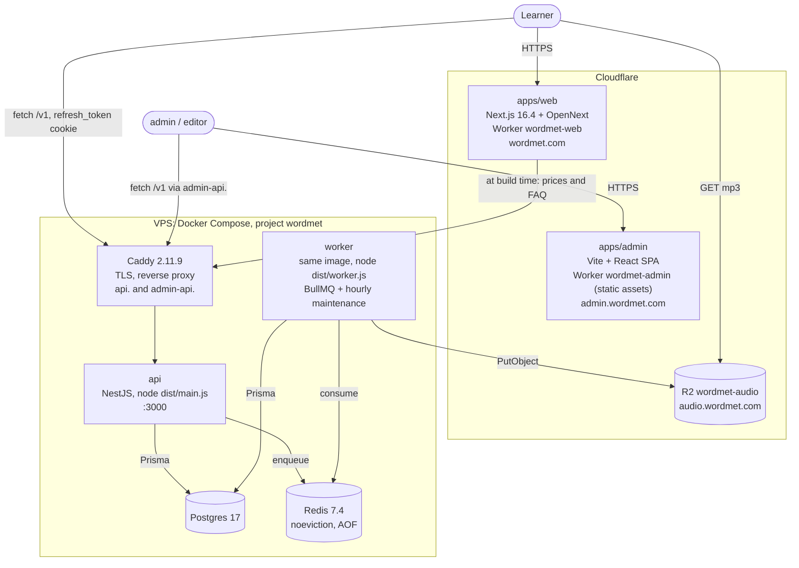
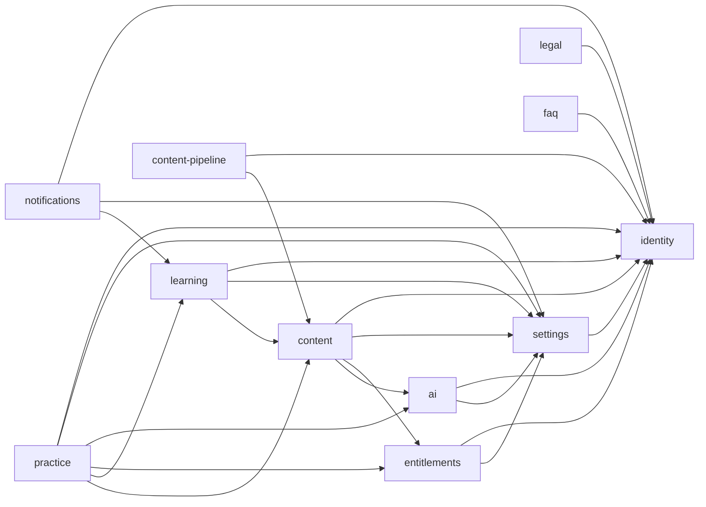
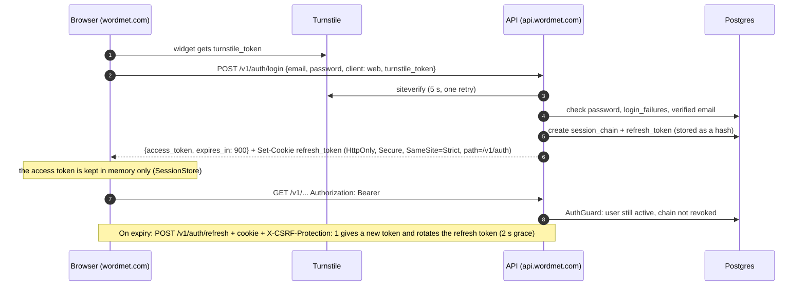
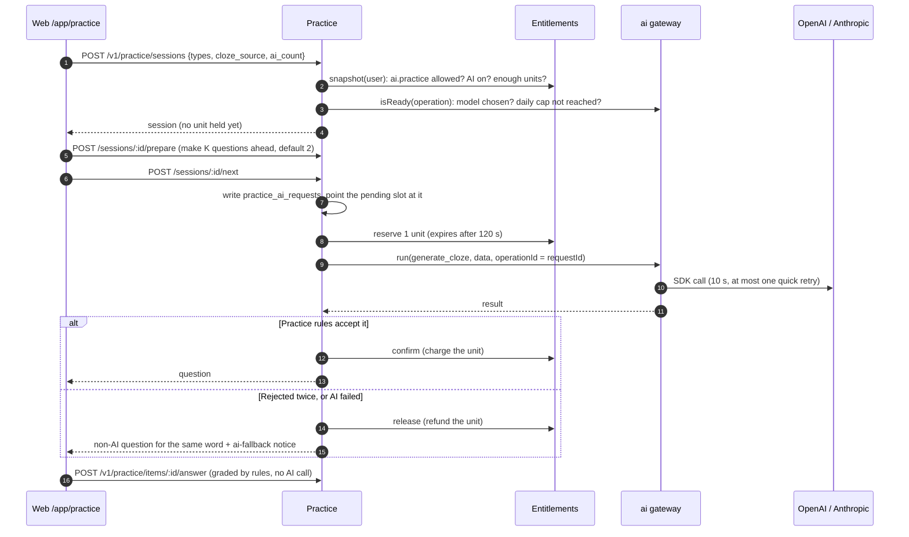
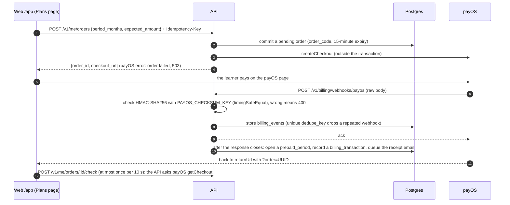
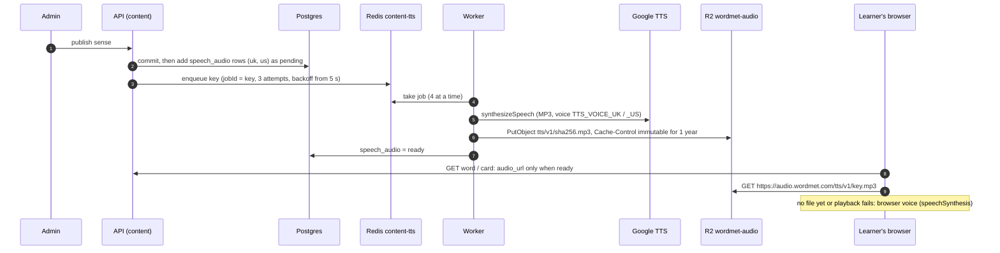
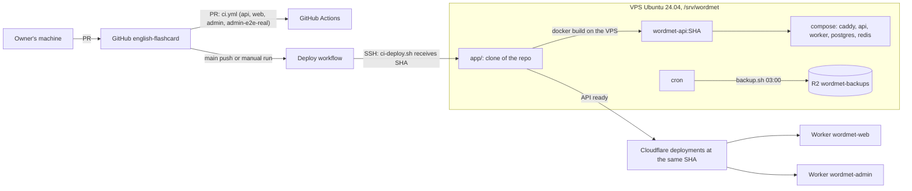

# Wordmet architecture

The architecture was first documented against commit `419fd0a0` on 14 November 2026. The deployment section was updated against `origin/dev` at `1bd8507f` on 16 November 2026, and synced on 20 November 2026 against `origin/main` (`0970665a` / `dev` `13ce8e9a`: restore-safety M1–M3, split DB roles, WAL-G 60s archiving, `main` ruleset). Each section cites its repository sources. Section 11 records the remaining verification gaps.

The outline uses arc42 with C4-style context and container views, sequence diagrams for runtime flows, and a deployment diagram. Section 9 links to the decision records.

**Keeping it current:** a PR that changes a container, a module, an external service or the way something is deployed updates the matching
section here. Step-by-step detail stays in the design docs (`docs/superpowers/specs/`) and the as-built records (`docs/deliveries/`); this
file is only the map.

## Contents

1. [Goals and scope](#1-goals-and-scope)
2. [Constraints](#2-constraints)
3. [Context: users and external services](#3-context-users-and-external-services)
4. [Solution strategy](#4-solution-strategy)
5. [Containers and modules](#5-containers-and-modules)
6. [Runtime flows](#6-runtime-flows)
7. [Deployment and operations](#7-deployment-and-operations)
8. [Cross-cutting conventions](#8-cross-cutting-conventions)
9. [Architecture decisions](#9-architecture-decisions)
10. [Testing and quality gates](#10-testing-and-quality-gates)
11. [Risks, technical debt, open questions](#11-risks-technical-debt-open-questions)
12. [Glossary](#12-glossary)

---

## 1. Goals and scope

Wordmet is an English vocabulary app for Vietnamese learners, organised by CEFR level (A1–C2) and topic. Learners save words into groups,
learn them with flashcards, review on a Leitner schedule, hear UK and US pronunciations, and practise with non-AI questions and AI-written
questions (graded by rules, never by the AI). The content team (`admin`, `editor`) writes, reviews and publishes words and grants plans in
the admin app. Sources: [README.md](../README.md), [PRODUCT.md](../PRODUCT.md).

Stakeholders:

| Who | Uses | Source |
|---|---|---|
| Learners (13 and older) | `apps/web`: landing at `wordmet.com` and the app at `/vi/app`, `/en/app` | [PRODUCT.md](../PRODUCT.md), `apps/api/src/identity/auth/auth.service.ts` (`MIN_AGE`) |
| `admin`, `editor` | `apps/admin` at `admin.wordmet.com` | [apps/admin/wrangler.jsonc](../apps/admin/wrangler.jsonc), `apps/api/src/identity/identity.types.ts` |
| The owner (operations) | The VPS, cron, alert emails, the daily report | [deploy/README.md](../deploy/README.md) |

What the system must keep true (shared business rules, [system-spec.md](specs/system-spec.md) SR1–SR15):

- **Entitlement is not quota** (SR4): "may I use it" is separate from "how many uses are left"; AI entitlement is checked when a question is
  created, not when it is graded.
- **Never do it twice** (SR8): operations with side effects accept an `Idempotency-Key`.
- **Logs hold no sensitive data** (SR10): no passwords, OTPs, tokens or raw answers; every log line carries `operation_id`.
- **Account deletion inside the app** (SR11), in order: mark "deleting" → revoke sessions → each module erases its data → delete the user.
- **AI spending has a ceiling**: a daily cap on provider calls and a switch that turns AI off (Bước 6 decision D24, section 6.2).

Out of scope today: the Flutter app (not started, [README.md](../README.md)). system-spec lists "real payments" and "study reminders" as
outside V1, but both were built later (payOS in launch prep B, reminders in Bước 3); see section 9.

## 2. Constraints

| Constraint | Set by | Source |
|---|---|---|
| NestJS modular monolith + PostgreSQL; Next.js web; Flutter mobile | The owner | [system-spec.md](specs/system-spec.md) "Constraints" |
| Errors as `application/problem+json` (RFC 9457), token pagination, `Idempotency-Key` | The owner (K2) | same |
| Credit CEFR-J and Octanove (CC BY-SA 4.0) | Data licences | same |
| Privacy policy and in-app account deletion | Apple, Google Play | same |
| Vietnam's Personal Data Protection Law 91/2025/QH15 | Law | same |
| One VPS with 4 CPUs and 8 GB; DNS points straight at the VPS (Cloudflare "grey cloud") | The owner (Q5, Q6, 13/11/2026) | [plans/2026-11-13-prod-deploy.md](superpowers/plans/2026-11-13-prod-deploy.md) line 18 |
| Build images on the VPS; GitHub Actions invokes the deploy script over SSH | Production deploy and subsequent automation | [Deployment](#7-deployment-and-operations) |
| Module boundaries are a convention, not checked by a tool | The owner (Bước 1 D3) | [Bước 1 decisions](superpowers/decisions/2026-10-07-buoc-1-identity-core-decisions.md) |

## 3. Context: users and external services

| External service | Used for | Turned on by | Fake for local work and tests | Source |
|---|---|---|---|---|
| Resend (SMTP) | Every email the app sends; alert emails use Resend's HTTP API separately | `SMTP_*`, `ops.env` | Mailpit (`docker-compose.yml`) | [env.production.example](../deploy/env.production.example), `apps/api/src/common/mail/smtp-mailer.ts`, `deploy/scripts/send-alert.sh` |
| payOS | Pro orders (payment link), webhook, status checks | `PAYOS_*` | `PAYOS_FAKE_ENABLED` | `apps/api/src/entitlements/billing/payos/payos.adapter.ts` |
| OpenAI, Anthropic | AI questions, AI lookup, private-word checks, judge | `OPENAI_API_KEY`, `ANTHROPIC_API_KEY` | `AI_FAKE_ENABLED` | `apps/api/src/ai/adapters/` |
| Google OAuth | Google sign-in (learners only) | `GOOGLE_*`, `OAUTH_COOKIE_KEY` | `GOOGLE_FAKE_ENABLED` | `apps/api/src/identity/google/` |
| Google Cloud TTS | UK and US pronunciation files (WaveNet) | `GOOGLE_TTS_CREDENTIALS`, `TTS_VOICE_*` | `TTS_FAKE_ENABLED` | `apps/api/src/content/audio/google-tts.adapter.ts` |
| Cloudflare R2 | Bucket `wordmet-audio` (public at `audio.wordmet.com`), bucket `wordmet-backups` | `AUDIO_STORAGE_*`, `R2_BACKUP_*` | `AUDIO_STORAGE_FAKE_ENABLED` (a local folder) | `apps/api/src/content/audio/r2-audio-storage.ts`, `deploy/scripts/backup.sh` |
| Cloudflare Turnstile | Bot check on sign-up, sign-in and OTP | `TURNSTILE_*` | `TURNSTILE_MODE=fake/off` | `apps/api/src/identity/turnstile/` |
| Cloudflare Workers | Runs `apps/web` and `apps/admin` | `wrangler.jsonc` | `pnpm dev`, local Docker | [apps/web/wrangler.jsonc](../apps/web/wrangler.jsonc) |
| Let's Encrypt | TLS certificates for `api.` and `admin-api.` | `ACME_EMAIL` | — | [deploy/Caddyfile](../deploy/Caddyfile) |
| Google AdSense | Ads on `/app/groups`, `/app/lookup` | a switch in admin | — | In the code (launch prep B, DB38); **off at launch** (prod-deploy Q4) |

Production refuses every fake: with `BILLING_PRODUCTION=true` the API will not start if any `*_FAKE_ENABLED=true` is set or `TURNSTILE_MODE`
is not `real` (`apps/api/src/common/config/app-config.ts` lines 346–399).

## 4. Solution strategy

- **One backend, many clients.** One NestJS `/v1` API serves the learner web, the admin app and (later) the Flutter app. There is no second
  service.
- **Modular monolith.** Each module owns its tables and calls other modules through their exported services (section 5.3).
- **One image for the API and the worker.** The worker is the same code started with `dist/worker.js` and `runWorkers: true`; it consumes
  the BullMQ queues (`apps/api/src/worker.ts`, `deploy/compose.prod.yml`).
- **What a user waits for runs in the request; only real background work is queued.** AI questions, grading and webhooks run directly;
  CSV import, bulk publish, pronunciation files, reminders and AI evals go through Redis (Bước 2 decision D6; [README.md](../README.md)).
- **Frontends at the edge, backend on one VPS.** Web and admin run on Cloudflare Workers; the API, worker, Postgres, Redis and Caddy run with
  Docker Compose on one VPS.
- **Every outside provider sits behind a port with a fake.** AI (`AiAdapter`), payments (`BillingAdapter`), mail (`Mailer`), TTS, file
  storage, Google, Turnstile. Tests and smokes never call a real service.

## 5. Containers and modules

### 5.1 Containers (C4 level 2)

| Container | Technology | Runs on | Talks to | Source |
|---|---|---|---|---|
| `apps/web` | Next.js 16.4.3, React 19.3, next-intl 4.14.9, `@opennextjs/cloudflare` 1.20.13 | Worker `wordmet-web`, routes `wordmet.com`, `www.wordmet.com` | The browser calls `https://api.wordmet.com` directly (`credentials: 'include'`); Next does not proxy the API | `apps/web/package.json`, `apps/web/wrangler.jsonc`, `apps/web/src/app-shell/api/client.ts`, `apps/web/src/app-shell/config.ts` |
| `apps/admin` | Vite 8.3, React 19.3, react-router 8.4 | Worker `wordmet-admin`, static files only (`not_found_handling: single-page-application`) | The browser calls `https://admin-api.wordmet.com` | `apps/admin/package.json`, `apps/admin/wrangler.jsonc`, `apps/admin/src/resolve-api-base-url.ts` |
| `caddy` | Caddy 2.11.9 | VPS, ports 80/443 (the only ports open to the internet) | `reverse_proxy api:3000`; JSON access log kept 7 days | [deploy/Caddyfile](../deploy/Caddyfile), [compose.prod.yml](../deploy/compose.prod.yml) |
| `api` | NestJS, Prisma, `MAINTENANCE_ENABLED=false` | VPS | Postgres, Redis (enqueue, readiness), external services | `apps/api/src/main.ts`, `compose.prod.yml` |
| `worker` | Same image `wordmet-api:<sha>`, `MAINTENANCE_ENABLED=true` | VPS | Redis (consume), Postgres, Google TTS, R2, SMTP | `apps/api/src/worker.ts`, `compose.prod.yml` |
| `migrate` | Image `wordmet-api-migrate:<sha>`, `prisma migrate deploy` | Runs once per deploy | Postgres | `compose.prod.yml` (profile `migrate`) |
| `postgres` | Postgres 17, `statement_timeout=300s` | VPS, volume `postgres_data` | — | `compose.prod.yml` |
| `redis` | Redis 7.4, `noeviction`, `appendonly yes` | VPS, volume `redis_data` | — | `compose.prod.yml` |
| `packages/design-tokens` | CSS (`theme.css`, `web.css`, `web-dark.css`) | Bundled into web and admin at build time | — | `packages/design-tokens/package.json` |

The two host names `api.` and `admin-api.` reach the same API. They are separate so the host-only `refresh_token` cookie (no `domain` set)
of learners and of staff never mix; a production web build requires a host starting with `api.`, a production admin build one starting with
`admin-api.`. The API does not tell the two hosts apart; staff permissions live in `PermissionGuard` (section 8). Sources:
`apps/api/src/identity/sessions/session-transport.ts` lines 13–15, `apps/web/src/app-shell/config.ts` lines 34–49,
`apps/admin/src/api-base-url-guard.ts`.

The landing pages (`/vi`, `/en`) are prerendered: during `next build` the web reads prices and FAQ from the API once and inlines them;
`LANDING_DATA_REQUIRED=1` turns a failed read into a build error. Hence **deploy the API before the web** (`apps/web/next.config.ts` lines
52–70, `.github/workflows/deploy-web.yml`).

### 5.2 API modules

The code has 12 business modules, more than the 7 in system-spec: `settings`, `notifications`, `legal` and `faq` were added in later steps,
next to `common` (shared infrastructure), `health` and `cli`. They are loaded in [app.module.ts](../apps/api/src/app.module.ts).

| Module (`apps/api/src/…`) | What it does | Tables (`apps/api/prisma/models/…`) |
|---|---|---|
| `identity` | Accounts, Argon2 passwords, sessions and refresh tokens, OTP, Google, staff roles, failed-login lock, account deletion | `identity.prisma`: `User`, `PasswordCredential`, `SessionChain`, `RefreshToken`, `OtpCode`, `OtpFailureWindow`, `LoginFailure`, `UserIdentity`, `DeletedAccount`, `PendingRegistration` |
| `content` | Catalog (entry, sense, revision), private words, context sentences, inflections, IPA and pronunciation files | `content.prisma`: `Topic`, `Entry`, `Sense`, `SenseRevision`, `EntryInflection`, `WordFormAddition`, `ContextSentence`, `SpeechAudio`, … |
| `content-pipeline` | CSV import/export, bulk publish, inflections; a background-job framework with leases | `pipeline.prisma`: `BackgroundJob`, `ImportBatch`, `ImportRowOutcome`, `PublishJob`, … |
| `learning` | Word groups, learning items, status, the Leitner review schedule, the log, study streaks | `learning.prisma`: `LearningGroup`, `LearningItem`, `GroupItem`, `LearningLogEntry`, `LearningActivityDay` |
| `practice` | Practice sessions, questions (6 types), rule-based grading, question reports, AI question quality | `practice.prisma`: `PracticeSession`, `PracticeQuestion`, `PracticeSessionItem`, `PracticeAiRequest`, `PracticeReport`, … |
| `entitlements` | Free/Pro plans, manual grants, the AI unit ledger, payOS orders, billing webhooks, transactions, plan emails | `entitlements.prisma`: `EntitlementGrant`, `UsageRecord`, `BillingEvent`, `BillingOrder`, `BillingOrderPayment`, `PrepaidPeriod`, `BillingTransaction`, … |
| `ai` | The AI gateway: models, per-operation config, prompts, calls, the cost ledger, evals, judge | `ai.prisma`: `AiModel`, `AiConfig`, `AiLiveConfig`, `AiOperationRecord`, `AiCall`, `AiCallContent`, `AiEvalRun`, `AiJudge`, … |
| `settings` | System settings admins can edit, with history | `settings.prisma`: `AppSetting`, `AppSettingChange` |
| `notifications` | Review reminder emails | `notifications.prisma`: `ReminderPref`, `ReminderDelivery` |
| `legal` | Privacy policy and terms, versioned | `legal.prisma`: `LegalVersion` |
| `faq` | The landing page FAQ | `faq.prisma`: `LandingFaqItem` |
| `common` | Config, Prisma, Problem Details, pagination, idempotency, rate limiting, logging, mail, the maintenance scheduler | `common.prisma`: `IdempotencyKey`, `RateLimitCounter`, `MailBudgetBucket` |

### 5.3 Module dependencies and data ownership

An arrow A → B means A's code imports B's services (counting `import … from '../B/'` in non-test files, 14/11/2026; `common` is left out
because every module uses it).

The convention (Bước 1 D3; [CLAUDE.md](../CLAUDE.md) "Module boundaries"):
- Each module has one file `apps/api/prisma/models/<module>.prisma`; only that module's code queries its tables.
- No Prisma `@relation` crosses modules; cross-module references are plain UUID columns.
- `src/common/**` never imports `src/identity/**` (true on 14/11/2026: `common` imports no module at all).
- This is checked in review only, **not by a tool**. This document did not re-check that every query follows it (UNVERIFIED).

The original write map (who may write what, and reads from whom) is in [system-spec.md](specs/system-spec.md), section "Bản đồ ghi dữ
liệu". Two points worth keeping in mind: Content Pipeline writes the catalog only through Content's operations; the provider cost ledger
(`ai_calls`) is separate from the learner unit ledger (`usage_records`) because the two counts differ when a call is retried.

#### Ngoại lệ truy cập bảng chéo module

Tất cả các ngoại lệ dưới đây đều là **đọc** (không ghi chéo module), được ghi nhận từ audit kiến trúc 23/11/2026 (`ARC-01`):

| File:dòng | Bảng | Lý do | Cách thay thế nếu gỡ ngoại lệ |
|---|---|---|---|
| `apps/api/src/content-pipeline/import/row-processor.ts:122` | `entry` (`content`) | Kiểm tra `entry` đã tồn tại trong cùng transaction nhập CSV trước khi ghi dòng | Export method đọc/lookup `entry` nhận `tx` từ `ContentService` |
| `apps/api/src/content-pipeline/import/row-processor.ts:124` | `entryInflection` (`content`) | Kiểm tra biến thể từ đã tồn tại khi xử lý dòng CSV trong cùng `tx` | Export method kiểm tra biến thể từ nhận `tx` từ `ContentService` |
| `apps/api/src/content-pipeline/import/row-processor.ts:166` | `entry` (`content`) | Tra cứu `entry` gốc cho cột liên kết `form_of` trong cùng `tx` | Export method tìm `entry` theo `(lemma, pos)` nhận `tx` từ `ContentService` |
| `apps/api/src/content-pipeline/inflections/inflections-backfill.handler.ts:41` | `entry` (`content`) | Quét theo lô các `entry` cần bổ sung biến thể trong job nền | Export iterator/batch reader cho `entry` từ `ContentService` |
| `apps/api/src/content-pipeline/inflections/inflections-backfill.handler.ts:53` | `entryInflection` (`content`) | Đọc các biến thể hiện có của lô `entry` để tránh ghi trùng | Export reader biến thể theo danh sách `entryId` từ `ContentService` |
| `apps/api/src/content/sources/sources.service.ts:203-208,224-229` (raw SQL) | `import_batches`, `import_row_keys` (`content-pipeline`) | Kiểm tra `NOT EXISTS` trước khi xóa `data_sources` (hai cột UUID chéo module không có FK), sau khi đã khóa `FOR UPDATE` | Export hàm kiểm tra nguồn đang được pipeline sử dụng nhận `tx` từ `ContentPipelineService` (cần tránh cycle `content ↔ content-pipeline`) |
| `apps/api/src/cli/accounts-deletions-args.ts:71,78` | `deletedAccount`, `user` (`identity`) | Lệnh CLI vận hành (`accounts:export-deletions`, `accounts:replay-deletions`) chạy trực tiếp khi phục hồi sau restore | Gọi qua `IdentityService` nếu muốn gom truy cập CLI vào facade của module |
| `apps/api/src/learning/retention/pilot-metrics.service.ts:61` | `billing_orders` (`entitlements`) | Gom số liệu pilot theo tuần (số đơn tạo / đã trả, loại staff) cho màn hình dashboard admin | Export method đếm/đọc đơn theo khoảng thời gian trên service của module `entitlements` |
| `apps/api/src/learning/retention/pilot-metrics.service.ts:65,68` | `practice_sessions` (`practice`) | Gom số phiên luyện và số phiên có câu AI (loại staff) cho số liệu pilot trên dashboard admin | Export method đếm phiên luyện theo khoảng thời gian trên service của module `practice` |

### 5.4 Queues and background work

| BullMQ queue | Work | Declared in |
|---|---|---|
| `content-import` | CSV import, with leases and reconciliation | `apps/api/src/content-pipeline/jobs/job-types.ts`, `import/import-batch.handler.ts` |
| `content-publish` | Publish by filter, no size limit | `content-pipeline/jobs/job-types.ts` |
| `content-inflections` | Load inflections | `content-pipeline/jobs/job-types.ts` |
| `content-tts` | Make pronunciation files; re-sweep every 5 minutes, clean up every 7 days | `apps/api/src/content/audio/tts-queue.service.ts` |
| `reminders` | `tick` picks who to remind, `send` sends the email | `apps/api/src/notifications/scheduler/reminder-queue.service.ts` |
| `ai-eval` | Eval runs and judge passes (started by an admin) | `apps/api/src/ai/eval/eval-queue.service.ts` |

Every queue uses the prefix `JOB_QUEUE_PREFIX` (production: `wordmet`). Consumers run only in a process with `runWorkers: true` (the worker).

**Hourly maintenance** (`MaintenanceScheduler`, not BullMQ): with `MAINTENANCE_ENABLED=true` the process runs every registered job once an
hour; a failing job is logged as `maintenance_job_failed` and does not stop the others. There are 23 jobs (counting `scheduler.register(...)`
on 14/11/2026): expiring idempotency keys, rate-limit counters, mail budget buckets and AI content older than 7 days, reconciling payOS
orders, retrying billing events, sending plan emails, retrying and sweeping account deletions, removing unverified accounts, cleaning up
practice. Sources: `apps/api/src/common/maintenance/maintenance.scheduler.ts`, the `*-maintenance.ts`, `*.job.ts` and `*-jobs.service.ts`
files.

In production the maintenance jobs run **twice an hour**, from two processes: the worker's own timer (`MAINTENANCE_ENABLED=true`, counted
from when the worker started) and cron calling `run-maintenance.js` at minute 15 ([deploy/README.md](../deploy/README.md)). This is safe
because the design requires every job to stay correct when two runs overlap (the comment at the top of `maintenance.scheduler.ts`). Checked
on 14/11/2026:

| Jobs | Why a second run does no harm | Source |
|---|---|---|
| Expiry cleanups (idempotency, rate limit, mail budget, AI content, `ai_operations`, practice, identity, import files, transactions, unit ledger) | Only `DELETE` / `UPDATE` rows already past their time; a second run finds nothing left | `practice-cleanup.service.ts`, `identity-cleanup.service.ts`, `usage-expire.job.ts`, `transactions-expire.job.ts`, `ai-maintenance.ts` |
| `entitlement-notices` (plan emails, receipts) | Rows are created with `skipDuplicates` on a unique key; each row is claimed with `FOR UPDATE SKIP LOCKED` and set to `sending` before the email goes, so no email is sent twice | `entitlements/notices/notice-sender.service.ts`, `notice-planner.service.ts` |
| `billing.orders-reconcile` | Orders are claimed with `SKIP LOCKED` while writing `checked_at`; an order asked in the last 10 minutes is skipped | `entitlements/orders/orders.repository.ts` (`claimForReconcile`) |
| `billing-events-retry`, `subscriptions-time`, `billing-refund-refetch` | Each row is locked with `SKIP LOCKED`; a write happens only if `updated_at` has not changed | `entitlements/billing/billing-jobs.service.ts` |
| `ai.models-refresh` | Each model is claimed with `UPDATE … info_checked_at` before the provider is asked: no model is described twice in 24 hours | `ai/maintenance/ai-maintenance.ts` |
| `ai.*-recover` | Re-queued with a fixed `jobId` (`runId`, `judge-<passId>`): BullMQ ignores a duplicate still in the queue | `ai/eval/eval-queue.service.ts` lines 78, 93 |
| `identity.deletion-retry`, `deletion-sweep`, `unverified-cleanup` | Deletion holds a per-user lock and treats a missing user as done; the sweep only re-runs the (idempotent) erasers | `identity/deletion/deletion-jobs.service.ts`, the `maintenance.scheduler.ts` comment |

The cost: twice the database work each hour (the largest is `deletion-sweep`, which re-runs the erasers for every account deleted in the
last 24 hours) and, when the two runs are more than 10 minutes apart, unresolved payOS orders are asked about twice an hour (at most 100
orders per run). The deploy plan does not say why the cron line was added; the likely effect (inferred, not confirmed): the jobs run on time
even right after a worker restart, since the worker's timer starts from zero after each deploy. The comment in `maintenance.scheduler.ts`
says the scheduler runs in "both the API and the worker"; in production the API sets `MAINTENANCE_ENABLED=false`, so the two processes are
actually the worker and cron.

**Email** is not queued (except reminders): `MailDispatcher` sends after the response has closed (`res.once('close')`) through nodemailer
SMTP and counts against the daily budget `MAIL_DAILY_BUDGET` (table `mail_budget_buckets`; reminders may use at most 80%, payment emails
95%). Once the budget is spent, OTP requests get 503 `mail-unavailable`. Sources: `apps/api/src/common/mail/mail-dispatcher.service.ts`,
`mail-budget.service.ts`.

## 6. Runtime flows

### 6.1 Sign-in (email + password, refresh, Google)

- Turnstile: sign-in still goes through when Cloudflare does not answer (logged as `turnstile_bypassed`); sign-up and OTP are refused
  (launch prep A DA12).
- The 10th wrong password locks the (account, IP) pair for 15 minutes; a success clears the counter (`identity/auth/credential-decision.ts`).
- Email not verified yet: 403 `email-not-verified`, and a new code is sent.
- JWT: HS256 with `jose`, `kid` from `JWT_KEYS` (keys can rotate), claims `sub`, `sid`, `iss`, `aud`
  (`identity/sessions/access-token.service.ts`).
- A refresh token lives at most 90 days from its latest issue and never past 365 days from when the chain was created; each person has at
  most 10 chains (`identity/sessions/session.service.ts`). Signing out revokes that device's chain. The `mobile` client receives the refresh
  token in the body.
- Tabs sync sign-in and sign-out through `BroadcastChannel` (`apps/web/src/app-shell/session/session-store.ts`).

**Google:** the browser opens `GET /v1/auth/google/start` → the API keeps `state`, `nonce` and the PKCE verifier in the sealed cookie
`google_oauth` (key `OAUTH_COOKIE_KEY`) and redirects to Google → Google calls `GET /v1/auth/google/callback` → the API checks `state`,
exchanges the `code`, then: a known Google identity signs in; a matching verified email is linked automatically; a new person goes to
`/{locale}/app/google/complete` to give a birth date and accept the terms before the account is created. Finally the API sets the refresh
cookie and redirects to `LEARNER_APP_URL`; the access token never travels in a URL. A session started with Google cannot reach staff routes
(403 `password-login-required`). Sources: `apps/api/src/identity/google/`, `identity/staff/permission.guard.ts` lines 33–36; Bước 8 decisions
D5, D6, D22.

### 6.2 Practice with AI questions

- Three AI question types: `cloze` (source `ai` or `own_then_ai`), `meaning_in_sentence`, `mcq_sentence`; they map to `generate_cloze`,
  `generate_meaning_question`, `generate_sentence_mcq` (`practice/ai/ai-session-planner.service.ts` lines 14–16).
- Every learner AI call runs **inside the request**, not through a queue (`practice/sessions/sessions.service.ts` lines 276–301).
- AI results are kept 24 hours by `operationId` in `ai_operations`: calling again with the same id returns the stored result without a
  second provider call.
- Each provider call writes one `ai_calls` row (tokens, cost); the text sent and received goes to `ai_call_contents`, kept 7 days (a
  setting).
- Daily cap: `ai.dailyProviderCallsCap` (default 3,000 learner calls, day boundary Asia/Ho_Chi_Minh); once reached, learner AI is off until
  midnight. Admin calls (test, eval, judge) have their own USD cap.
- Model, effort and prompt per operation are read from `ai_live_configs` on every call (no cache); admins change them in `apps/admin`.
- The judge is not on the learner's path: an admin starts it and it runs on the `ai-eval` queue.

Sources: `apps/api/src/practice/ai/ai-question-generator.service.ts`, `apps/api/src/ai/runner/runner.service.ts`, `run-rules.ts`,
`call-ledger.service.ts`, `readiness.service.ts`, `apps/api/src/ai/configs/live-config.reader.ts`,
`apps/api/src/settings/settings.definitions.ts`; decisions Bước 6 D4, D11, D23, D24 and Bước 7.

### 6.3 Buying Pro through payOS, and the webhook

- No webhook (lost or late): the maintenance job `billing.orders-reconcile` asks payOS every hour, up to 100 orders; events stuck in
  `pending` are retried by `billing-events-retry`.
- The Pro period continues from the end of any current Pro and ends rounded up to the next midnight in the learner's time zone (DB8, DB35).
- Underpaid, overpaid or late: the order becomes `needs_review` for an admin; admins also have a "Payment received" fallback button (DB4,
  DB16, DB20).
- Receipt email: an `entitlement_notices` row of kind `payment_receipt`, sent by the `entitlement-notices` job.

Sources: `apps/api/src/entitlements/orders/` (`me-orders.controller.ts`, `orders.service.ts`, `order-applier.service.ts`,
`orders-reconcile.job.ts`), `apps/api/src/entitlements/billing/` (`webhook.controller.ts`, `billing-inbox.service.ts`,
`payos/payos-signature.ts`), `apps/api/src/app.setup.ts` lines 35–38 (raw body); launch prep B decisions DB1–DB39.

### 6.4 Pronunciation files (Google TTS → R2)

- File key = sha256 of `voice name | text | phonemes`; identical text shares one file (DC22).
- If the queue cannot be reached the rows stay `pending`; the `tts-sweep` job re-queues them every 5 minutes. There is a daily character cap:
  once reached, jobs wait until 00:00 UTC without spending an attempt.
- Senses published before TTS was on: run `node dist/cli/tts-backfill.js` in the worker (deploy README).
- The `/app` CSP `media-src` allows the `NEXT_PUBLIC_AUDIO_BASE_URL` origin; without it the browser blocks the files.

Sources: `apps/api/src/content/content.service.ts` (calls `audio.ensureForSenses` after publish), `content/audio/audio.service.ts`,
`tts-queue.service.ts`, `tts-worker.service.ts`, `google-tts.adapter.ts`, `r2-audio-storage.ts`, `audio-key.ts`,
`apps/web/src/ui/SpeakButton.tsx`, `apps/web/src/lib/app-csp.ts`; improvement round C decisions DC19–DC24.

## 7. Deployment and operations

### 7.1 Deployment diagram

| Part | How it reaches production | Rollback | Source |
|---|---|---|---|
| API + worker | Deploy workflow calls `ci-deploy.sh` over SSH, which runs `deploy.sh <sha>` on the VPS | `rollback.sh <sha>`: starts an image already on the machine (the 3 newest), never builds, never migrates | [deploy/README.md](../deploy/README.md), `deploy/scripts/deploy.sh` |
| Web | Deploy workflow builds the same SHA after the API passes readiness | `wrangler rollback --name wordmet-web` | [.github/workflows/deploy-web.yml](../.github/workflows/deploy-web.yml) |
| Admin | Deploy workflow builds and deploys the same SHA after the API passes readiness | `wrangler rollback --name wordmet-admin` | [deploy/README.md](../deploy/README.md) "Admin web" |

The [Deploy workflow](../.github/workflows/deploy-web.yml) runs on pushes to `main` or manual dispatch. Manual dispatch accepts a full SHA on `main` and defaults to its head. `DEPLOY_PAUSED=true` skips automatic runs. The web and admin jobs both wait for the API job.

**`deploy.sh`**, in order: refuse a checkout with local changes → check out `<sha>` → build `wordmet-api:<sha>` (target `api-prod`) and
`wordmet-api-migrate:<sha>` (target `api-build`) → backup (skipped on the first deploy) → migrate → `compose up` → wait up to 120 seconds for
`GET /v1/health/ready`. Not ready: start the previous version again and exit 1. Migrations are add-only, so older code runs on the newer
database; that is why rollback never migrates down.

**`/v1/health/ready`**: Postgres `SELECT 1` and Redis `PING`, at most 2 seconds each; failure returns 503 (`apps/api/src/health/`). The `api`
container's healthcheck calls it every 10 seconds.

### 7.2 Day-to-day operations

| Task | When (Vietnam time) | What it does | Source |
|---|---|---|---|
| `watch.sh` | every 5 minutes | Alert email for: 5+ `request_failed`, `maintenance_job_failed`, `account_deletion_failed`, `turnstile_bypassed`, WAL-G archive failures (`archive`), disk above 80% or under 15 GB / 8 GB, less than 300 MB of memory, a service stopped or restarted. At most one email per kind per hour, sent through Resend's HTTP API. (External uptime monitor: UptimeRobot calling `/v1/health/ready`, owner-confirmed 20/11/2026.) | `deploy/scripts/watch.sh`, `send-alert.sh` |
| `daily-report.sh` | 08:00 | Accounts, learners, sessions, AI calls and cost, paid orders, emails sent; 5xx count and p95 from the Caddy log; newest backup and `PITR:` status line; disk, memory | `deploy/scripts/daily-report.sh`, `daily-report.sql` |
| `backup.sh` | 03:00 and before every deploy | `pg_dump -Fc` (3 local copies, 14 on R2) plus daily WAL-G base backup (14 kept on R2; skipped pre-deploy via `BACKUP_SKIP_BASE=1`). Postgres (`wordmet-postgres:17-walg-3.0.9`) runs `archive_mode=on` pushing WAL segments to R2 every 60 seconds; failure sends an email | `deploy/scripts/backup.sh`, `deploy/compose.prod.yml` |
| `run-maintenance.js` | minute 15 of every hour | Runs every maintenance job once in the worker container | [deploy/README.md](../deploy/README.md) |

Database roles (rolled out 18/11/2026, `docs/deliveries/restore-safety.md`): API, worker and CLI connect as `wordmet_app` (DML only, no DDL/TRUNCATE/schema changes); migrations run as `wordmet_migrator` (owns schema objects in `public`); `backup.sh` and `daily-report.sh` still use `POSTGRES_USER`.

Restore: either PITR via WAL-G (`wal-g backup-fetch` + WAL replay) or `pg_dump` into an **empty** database, migrate up to the running code, then replay accounts deleted after the restore point via the R2 Deletion Journal (`accounts-deletions.js replay --journal`, Bước 8 D21 + PR #302/#305). Full steps: [deploy/README.md](../deploy/README.md) "Backup and restore".

Secrets: `/srv/wordmet/.env` and `ops.env` (chmod 600), created from `deploy/env.production.example` and `deploy/ops.env.example`; web and
admin get public variables at build time; the Cloudflare keys used by Actions live in the `deploy-env` environment. Only Caddy opens ports
80/443 to the internet; SSH is key-only.

## 8. Cross-cutting conventions

| Topic | Convention | Code |
|---|---|---|
| API versioning | `/v1` prefix; within v1 only additions, field meanings never change | `apps/api/src/app.setup.ts` line 56; SR7 |
| Errors | `application/problem+json` (RFC 9457): `type`, `status`, `title`, `detail`, `instance`, `operation_id` | `common/problem-details/problem-details.filter.ts` |
| Pagination | `page_size` (default 20, max 100) + an opaque `page_token` (base64url JSON) | `common/pagination/page-token.util.ts` |
| Idempotency | `Idempotency-Key` scoped to (user, endpoint); locked with `pg_try_advisory_xact_lock`; same key and body replays the result, a different body is refused, in-flight returns 409; Identity endpoints do not use it | `common/idempotency/idempotency.interceptor.ts`, `idempotency.service.ts`; SR8 |
| Authentication | Global `AuthGuard`: Bearer JWT, then a database read of the user and session chain on every request (sign-out takes effect at once; accounts being deleted are blocked) | `identity/sessions/auth.guard.ts`; Bước 8 D24, D29 |
| Staff permissions | Roles `admin` (9 permissions) and `editor` (7); `@RequirePermission(...)` + `PermissionGuard` read the role from the database, not the JWT; staff must change a temporary password first | `identity/identity.types.ts`, `identity/staff/permission.guard.ts` |
| CSRF | `SameSite=Strict` cookie + a required `X-CSRF-Protection: 1` header on refresh and the other cookie-based calls | `identity/sessions/session-transport.ts` |
| Rate limiting | Fixed windows counted in Postgres (`rate_limit_counters`), 429 with `retry-after` | `common/rate-limit/rate-limiter.service.ts`; Bước 1 D11 |
| Logging | JSON lines to stdout with `operation_id` (AsyncLocalStorage), sensitive values redacted; no pino | `common/logging/app-logger.ts`, `operation-id.middleware.ts`; SR10 |
| Configuration | Environment variables validated with `zod` at startup; anything wrong or missing stops the process; fakes refused when `BILLING_PRODUCTION=true`; `OPENAI_CUSTOM_HEADERS` / `ANTHROPIC_CUSTOM_HEADERS` refused everywhere | `common/config/app-config.ts` lines 339–422; Bước 6 D29 |
| API security headers | Helmet: CSP `default-src 'none'`, `frame-ancestors 'none'`, `no-referrer`; JSON bodies up to 100 KB; CORS only for origins in `CORS_ORIGINS` | `apps/api/src/app.setup.ts` lines 15–53 |
| Web CSP | `/vi/app`, `/en/app` get a CSP with a per-request `nonce`; the landing is static | `apps/web/src/proxy.ts`, `apps/web/src/lib/app-csp.ts`; CI `assert:render-mode` |
| Time | Stored in UTC; day boundaries (quotas, streaks, Pro periods) follow the learner's IANA time zone | SR13; `entitlements/orders/order-applier.service.ts` |
| Languages | Web and admin: `vi` (default) and `en` | `apps/web/src/i18n/routing.ts`; Bước 2.5 D6 |
| UI | Shared colour and font tokens from `packages/design-tokens` | `apps/web/src/app/globals.css`, `apps/admin/src/styles/globals.css` |
| Account deletion | Runs in the request; on failure the account stays "deleting" and a maintenance job retries; money transactions are kept under an anonymous id | SR11; Bước 8 D15, D23 |

## 9. Architecture decisions

Each row is a settled decision; the link leads to the decision record with every option and its trade-offs (records are in Vietnamese).

| Decision | Chosen | Instead of | Record |
|---|---|---|---|
| Backend style | NestJS modular monolith + Postgres | — (a constraint from the start) | [system-spec.md](specs/system-spec.md) |
| ORM | Prisma (row locks via `pg_try_advisory_xact_lock`) | Drizzle (the first Bước 0 build) | [plans/2026-10-06-migrate-drizzle-to-prisma.md](superpowers/plans/2026-10-06-migrate-drizzle-to-prisma.md) |
| Module boundaries | Convention: one `.prisma` file per module, cross-module calls through services | A source-scanning test; no split | [Bước 1 D3](superpowers/decisions/2026-10-07-buoc-1-identity-core-decisions.md) |
| Authentication | Hand-written guard + `jose`; web refresh cookie from Bước 1 on | Passport | [Bước 1 D4, D5](superpowers/decisions/2026-10-07-buoc-1-identity-core-decisions.md) |
| Staff permissions | Role → list of permissions; `admin`, `editor` | One admin flag | [Bước 1 D6](superpowers/decisions/2026-10-07-buoc-1-identity-core-decisions.md) |
| Web and API share the root domain | `wordmet.com` + `api.wordmet.com` | Different domains | [Bước 1 D13](superpowers/decisions/2026-10-07-buoc-1-identity-core-decisions.md) |
| Mail | `Mailer` port + fake + SMTP, with a daily budget | Locking into personal Gmail | [Bước 1 D2](superpowers/decisions/2026-10-07-buoc-1-identity-core-decisions.md); Resend in [env.production.example](../deploy/env.production.example) |
| Background work | BullMQ + Redis, for real background work only; a job framework with leases | A queue in Postgres | [Bước 2 D6, D14](superpowers/decisions/2026-10-12-buoc-2-content-pipeline-decisions.md) |
| Admin app | Separate `apps/admin`, Vite + React SPA | Inside `apps/web` | [Bước 2.5 D1, D3](superpowers/decisions/2026-10-14-buoc-2-5-admin-web-decisions.md) |
| When to deploy | Once the whole app is done, before launch | Right after Bước 3 | [Bước 3 D3](superpowers/decisions/2026-10-16-buoc-3-learning-decisions.md) |
| Backend tests | No HTTP e2e for the API; unit tests + smokes on a fresh database | Keep the e2e suite | [Bước 4 D38, D42](superpowers/decisions/2026-10-18-buoc-4-practice-decisions.md) |
| Plans and units | Per-feature entitlements, a unit ledger that counts rows, a generic billing port | An `is_pro` flag | [Bước 5 D3, D28](superpowers/decisions/2026-10-19-buoc-5-entitlements-decisions.md) |
| AI gateway | One `ai` module, OpenAI + Anthropic, admins pick the model per operation, no automatic provider switch; 10 s, one quick retry; results kept 24 h; daily call cap | A model fixed in code | [Bước 6 D2, D4, D6, D13, D16, D23, D24](superpowers/decisions/2026-10-20-buoc-6-ai-integration-decisions.md) |
| AI questions in practice | Called in the request, a unit held first, falls back to a non-AI question | A queue | [Bước 7](superpowers/decisions/2026-10-21-buoc-7-practice-ai-content-ai-decisions.md) |
| Google sign-in, account deletion | Through the API (redirects); deletion in the request, retried by a job | The web calling Google itself | [Bước 8 D22, D23](superpowers/decisions/2026-10-28-buoc-8-identity-remainder-decisions.md) |
| Bot protection | Turnstile on sign-up, sign-in and OTP (web and admin) | Rate limits only | [Launch prep A DA9, DA12](superpowers/decisions/2026-11-04-chuan-bi-launch-a-decisions.md) |
| Payments | payOS (VietQR), paid per period of 1/3/12 months, webhook + a fallback button | Auto-renewal (Bước 5 D35) | [Launch prep B DB1–DB4, DB28–DB34](superpowers/decisions/2026-11-04-chuan-bi-launch-b-decisions.md) |
| Pronunciation | Google Cloud TTS WaveNet, made at publish time, files on R2 | Browser voice only | [Round C DC19–DC24](superpowers/decisions/2026-11-06-dot-cai-thien-c-decisions.md) |
| Production infrastructure | 1 VPS with 4 CPUs, 8 GB; DNS straight to the VPS; TypedSQL dropped, multi-stage image; deploy through GitHub Actions and a VPS script; `DEPLOY_PAUSED` switch; TTS and Google on at launch, AdSense off | PaaS | [plans/2026-11-13-prod-deploy.md](superpowers/plans/2026-11-13-prod-deploy.md) lines 18–19 (Q4–Q14); [prod-deploy.md](deliveries/prod-deploy.md); [current workflow](../.github/workflows/deploy-web.yml) |

**Decisions since replaced, or out of line with the code** (the decision records have no Status field):
- Landing DP3 chose Cloudflare **Workers Builds**; the code deploys with **GitHub Actions + `wrangler deploy`** since 09/10/2026 (commit
  `e0e1254f`, [deploy-web.yml](../.github/workflows/deploy-web.yml)). Landing DP1 (a waitlist on D1) was dropped in the 03/11/2026 landing
  redesign.
- Bước 5 D35 (auto-renewing plans only) was replaced by launch prep B DB1 (VietQR, paid per period).
- system-spec lists "real payments" and "reminders" as outside V1 and has "7 modules"; the code has payOS, email reminders and 12 modules.

## 10. Testing and quality gates

- **CI** (`.github/workflows/ci.yml`, runs on PRs only): job `api` (lint, typecheck, build, unit, schema drift with `prisma migrate diff`),
  `web` (lint, typecheck, unit, Playwright + axe, landing static and `/app` rendered per request, JS size check), `admin` (lint, typecheck,
  unit, build with the production host guard, e2e against a mocked API), `admin-e2e-real` (admin against a real API, worker, Postgres, Redis,
  Mailpit).
- **Smokes** for each step run on a fresh database with every provider faked (`pnpm smoke:buoc-*`); outputs are kept in
  `docs/deliveries/*-smoke-output.txt`.
- There is **no** HTTP e2e for the API (Bước 4 D38) and no test runs on merge into `main`: a green CI on the PR is the only gate
  ([CLAUDE.md](../CLAUDE.md) "Branching model").
- The deploy path was rehearsed locally (deploy, second deploy, rollback, broken deploy, alerts); what can only be checked on the VPS is in
  section 11. Source: [prod-deploy.md](deliveries/prod-deploy.md).

## 11. Risks, technical debt, open questions

| # | Risk / question | Affects | Source |
|---|---|---|---|
| R1 | **One VPS is a single point of failure**: the API, worker, Postgres and Redis share one machine. If it dies the whole app is down. Since 18/11/2026 WAL-G archives WAL to R2 every 60 seconds alongside daily `pg_dump` + base backup (`pg_dump` restore from R2 rehearsed 15/11 in ~9 s; local WAL-G PITR spike rehearsed 21/11 in [2026-11-21-pitr-drill/README.md](audit/2026-11-21-pitr-drill/README.md); production VPS PITR and `replay-deletions --journal` from R2 remain to be rehearsed) | Whole system | `deploy/compose.prod.yml`, Q5, `docs/deliveries/restore-safety.md` |
| R2 | **Production checks after infrastructure changes**: Caddy TLS, `pg_dump` backup+restore from R2 (15/11), Resend SMTP, Google TTS → R2 (`audio.wordmet.com`, 9,481 files) and a real payOS purchase (14/11) are confirmed live. Still unverified on production: WAL-G PITR restore + R2 Deletion Journal replay, real Google OAuth flow confirmation, post-18/11 time-based `orderCode` / `orders:probe-payos`, and cron UTC timing / IPv6 rate-limit edge cases | Launch | [prod-deploy.md](deliveries/prod-deploy.md), [restore-safety.md](deliveries/restore-safety.md) |
| R3 | **15 Minor points from the deploy review left for after launch**; worth doing early: keep keys off the command line (`ps`), `umask 077` for dumps, `curl --max-time`, `flock` | Operations | [prod-deploy.md](deliveries/prod-deploy.md); [current workflow](../.github/workflows/deploy-web.yml) |
| R4 | **Module boundaries are not checked by a tool**: a violation is only caught in review | Maintainability | Bước 1 D3 |
| R5 | **Automatic Google linking by email** when the email is not managed by Google: deferred, to review before launch | Account security | Bước 8 D26 |
| R6 | **Maintenance jobs run twice an hour** (worker + cron). All 23 jobs checked on 14/11/2026: safe by design, at the cost of twice the database work (section 5.4). The launch runbook recorded that cron keeps its schedule when a deploy restarts the worker. New jobs must keep the "two overlapping runs stay correct" rule | Database load; a badly written new job could send duplicates | section 5.4, `maintenance.scheduler.ts`, deploy README "cron" |
| R7 | **Rate limits are counted in Postgres**: one upsert per write request. This document does not establish the current capacity limit | Performance | `rate-limiter.service.ts`; deploy-checklist "Đo tải trước launch" |
| R8 | **The web deploy depends on the API**: the landing build reads prices and FAQ from the API; with the API down the web cannot deploy | Releases | `next.config.ts`, `deploy-web.yml` |
| R9 | **Branch protection (checked 20/11/2026):** `main` IS protected by active ruleset `validate-before-merge-main` (id `24639679`: PR required, 4 required checks `api`/`web`/`admin`/`admin-e2e-real`, strict up-to-date, no bypass). `dev` currently has **no** branch protection (`404 Branch not protected`) and `deploy-env` has no protection rules | Unchecked code could still be pushed or merged to `dev` (blocked only at the `dev` → `main` PR gate) | GitHub Rulesets API (`20/11/2026`) |

The full pre-launch list: [deliveries/deploy-checklist.md](deliveries/deploy-checklist.md).

## 12. Glossary

| Term | Meaning |
|---|---|
| Entry, sense | A word (lemma + part of speech); one meaning of it, with a stable ID. Learning progress follows the sense |
| Catalog | Words and senses the content team publishes, visible to every learner |
| Private word | A word a learner adds; only that learner sees it |
| Entitlement, quota | Whether a feature may be used; how many uses are left |
| AI unit, reservation | One unit in the `usage_records` ledger; held before an AI call, charged when a question is made, released on failure |
| AI operation | One job of the AI gateway: `generate_cloze`, `lookup_word`, `translate_sentence`, `generate_meaning_question`, `generate_sentence_mcq`, `check_private_word`, `judge` |
| Operation ID | The id of one operation, used to trace logs and to avoid doing it twice |
| Session chain | One signed-in session on one device; the refresh token rotates within the chain |
| Prepaid period | A stretch of Pro created by one paid payOS order |
| Container (C4) | Something that runs or stores data: web, admin, API, worker, Postgres, Redis. Not the same as a Docker container |
| Grey cloud | A Cloudflare DNS record not proxied by Cloudflare: requests go straight to the VPS |
| Bước | "Step": the build steps 0–8 the project was built in; each has a design doc, a decision record and an as-built record |
