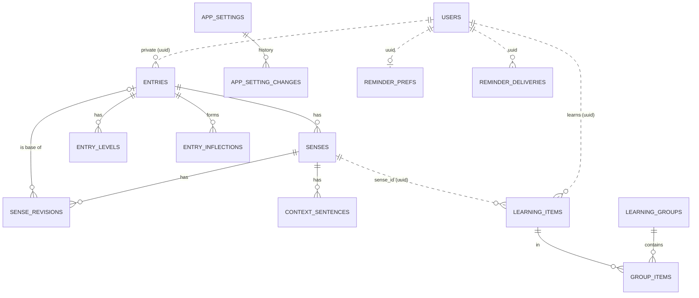

# Design — Bước 3: Learning (kèm phần Content dời từ Bước 2)

> **Trạng thái 17/10/2026: chưa duyệt toàn bộ.** Phần hệ thống (mục 1–15) đã trình bày từng phần và chủ dự án duyệt trong chat;
> đã rà lại một lượt (`../reviews/2026-10-17-buoc-3-design-plan-review.md`). **Phần giao diện (mục 16) làm ở phiên riêng** và có
> plan riêng. Mục 17 trỏ sang plan hệ thống (D41). "Xong khi": chủ dự án tự báo khi Bước 3 xong (D45). Nguồn dạng chia: AGID (D46). Đang implement theo plan hệ thống.

Ngày: 16–17/10/2026. Brainstorm qua `superpowers:brainstorming` trên nhánh `docs/buoc-3-design` (cắt từ `origin/dev` @ `e1ba729`),
theo luật "chủ dự án trả lời trước, Claude đề xuất sau" (CLAUDE.md, Working Rules). Quyết định, mọi phương án đã đưa ra và
trade-off: [`../decisions/2026-10-16-buoc-3-learning-decisions.md`](../decisions/2026-10-16-buoc-3-learning-decisions.md).
Context giao diện: [`../../mockups/2026-10-16/UI-CONTEXT.md`](../../mockups/2026-10-16/UI-CONTEXT.md).

**Nhãn:** **Chốt** = chủ dự án chọn trong chat. **Đề xuất** = Claude đề xuất, duyệt cùng phần chứa nó. **ASSUMPTION** = chưa
kiểm chứng. Design doc là tài liệu chính thức để build; `docs/specs/` là khung ban đầu, không sửa theo doc này (chủ dự án,
12/10/2026). Mã spec (LR#, CR#, K#…) chỉ để truy nguồn. Quyết định `D#` (trong decision record), tiêu chí `B3#`, edge case `B3E#`.

## 1. Mục tiêu và bối cảnh

Bước 3 đưa vòng học tới tay người dùng: **gom từ đã gặp → ôn đúng lúc theo nhóm**, kèm phần Content dời từ Bước 2 (từ riêng tư,
câu ngữ cảnh, chuỗi tra nghĩa) và nhắc học qua email.

Các quyết định trước khi chốt phạm vi (Q-A đến Q-D của `docs/preparation/PROJECT_ASSESSMENT_2026-10-15.md`):

| Câu | Chốt |
|---|---|
| Q-A thứ tự, phạm vi | **Bước 3 đầy đủ** (không làm bản thu nhỏ). **Chỉ web**, Flutter để sau. Chuỗi tra nghĩa chỉ gồm catalog và tự nhập (không có từ điển ngoài, không AI), theo HANDOFF §2 |
| Deploy | Bước "Deploy API + admin" làm **ngay sau Bước 3**, để từ đó tới khi app hoàn chỉnh mọi trục trặc deploy kịp lộ ra |
| Q-B nội dung | AI soạn nháp CSV **ngoài app**, chủ dự án duyệt, import bằng luồng CSV có sẵn. Thử trước một lô ~20 từ để đo thời gian duyệt. Đích: đủ ~8.812 từ (CEFR-J + Octanove). Soạn nội dung không phải code của Bước 3 |
| Q-C nhắc học | **Có** nhắc học tự động (thay K25). Hướng sản phẩm: push trên mobile là chính, email thưa hơn, nội dung chung chung ("Tới giờ học từ vựng"). **Bước 3 chỉ làm email**, thiết kế theo notification provider |
| Q-D ngưỡng | **Không khảo sát thêm; không đổi thứ tự bước cho tới khi app hoàn chỉnh; chỉ tìm người dùng khi app hoàn chỉnh.** Chủ dự án là người dùng thử. Ngưỡng thành công dời tới trước ngày ra mắt (đề xuất). Rủi ro "xây tới hết V1 mà chưa có bằng chứng hành vi" được chấp nhận và ghi ở mục 19 |
| Phần lõi tự viết | **Không có** ở Bước 3: Claude viết code và test; chủ dự án duyệt **hành vi** qua bảng ví dụ ở mục 6.4 |

## 2. Quyết định (tóm tắt)

Đủ chi tiết, phương án bị loại và trade-off ở decision record. Các thay đổi so với quyết định cũ:

| Quyết định cũ | Thay bằng | D# |
|---|---|---|
| K10 (publish cần ít nhất một chủ đề) | Chủ đề **không bắt buộc** khi publish | D7 |
| LR4, F20 (ba trạng thái chưa học / cần ôn tập / đã biết; lọc phiên theo trạng thái) | **Mức 0–5 + cờ ưu tiên**, flashcard hai nút. K13 (một trạng thái mỗi người mỗi nghĩa, dùng chung mọi nhóm) và K14 (nhật ký chỉ thêm) **giữ nguyên** | D17 |
| K22 (kết quả bài làm tác động vào lịch ôn) | Hệ thống **không tự** tăng/giảm mức; bài làm chỉ **gợi ý** nút "Cần ôn tập" (áp dụng Bước 4) | D16 |
| Hướng "quên khác nhầm" (15/10) | Bỏ; không cần phân biệt | D16 |
| K25 (không nhắc học) | Có nhắc học; Bước 3 qua email | D8, D9 |
| F34 (Free không giới hạn theo gói, trừ AI) | Giới hạn nhóm, từ mỗi nhóm, từ riêng tư sẽ thành **hạn mức theo gói** ở Bước 5 | D23 |
| L8 (`app.` là web app) | App người học ở **chung domain `wordmet.com`**, trong `apps/web` | D15 |
| N8, N9 (luật lên xuống, trần 10/50) | Luật ở mục 6; trần 20 mới / 100 ôn **mỗi nhóm** | D16, D21 |
| CR16 (nguồn dạng chia: chưa có) | Bảng tra dạng chia (thư viện sinh + duyệt) ở Bước 3 | D29 |
| D28 của chính Bước 3 (thêm nhanh vào nhóm mặc định "Mới thêm") | Không có nhóm mặc định; thêm từ phải chọn hoặc tạo nhóm | D43 |

## 3. Phạm vi

**Làm:**
- **Learning** (module mới): nhóm, mục học (mức 0–5, cờ ưu tiên, ngày hẹn), phiên ôn theo nhóm, danh sách cân nhắc, nhật ký.
- **Content** (mở rộng): từ riêng tư (tạo, sửa, xóa), câu ngữ cảnh, bảng tra dạng chia, link "dạng chia → từ gốc" ở từng nghĩa,
  trang từ (một trang mỗi chữ), tìm theo chữ, tra cho thêm nhanh, chủ đề không bắt buộc khi publish.
- **Content Pipeline**: cột dạng chia khi import/xuất; xuất CSV "từ chưa có nghĩa" (D34; việc tồn D26 của Bước 2.5); job sinh dạng chia cho
  các entry đang có.
- **Notifications** (module mới): cổng `NotificationProvider`, bản cài email, lớp chọn kênh, lịch nhắc, nấc vắng mặt.
- **Settings** (module mới): cài đặt admin chỉnh được, có khoảng cho phép và lịch sử đổi.
- **Identity**: quyền `settings.manage` (chỉ `admin`); hàm cho module khác đọc email đã xác minh và lần dùng phiên gần nhất.
- **`apps/web`**: app người học dưới một đường dẫn của `wordmet.com` (giao diện: mục 16).
- **`apps/admin`**: trang "Thông báo & giới hạn"; lựa chọn "Từ chưa có nghĩa" ở màn xuất CSV.

**Không làm:** Flutter, push, bài luyện (Bước 4), AI và từ điển ngoài, đăng nhập Google và xóa tài khoản (Bước 8), quản lý
mẫu email theo từng loại thông báo (bàn sau), chỉnh giới hạn theo từng người dùng (Bước 5), FSRS (xét sau khi có dữ liệu).

## 4. Kiến trúc

```
wordmet.com  (apps/web, Next.js 16.3.8, một Worker Cloudflare)
 ├─ landing: server dựng sẵn; không script bên thứ ba; CSP cho cả domain
 └─ /vi/app/…, /en/app/… : app người học, chạy hoàn toàn ở trình duyệt; tắt trên production cho tới bước Deploy
        │ fetch kèm cookie (refresh_token host-only trên api., SameSite=Strict, path /v1/auth)
        ▼
api.wordmet.com  (apps/api, NestJS)                 admin.wordmet.com (apps/admin) → admin-api.wordmet.com
 ├─ Identity        + settings.manage; IdentityService: verifiedEmails(userIds), lastSeenAt(userIds)
 ├─ Content         + từ riêng tư, câu ngữ cảnh, dạng chia, trang từ, tra
 ├─ Content Pipeline+ cột dạng chia, xuất "chưa có nghĩa", job sinh dạng chia
 ├─ Learning        mới
 ├─ Notifications   mới: lịch nhắc → lớp chọn kênh → NotificationProvider → EmailProvider
 └─ Settings        mới
worker (dist/worker.js): + job nhắc học (BullMQ Job Scheduler) + job sinh dạng chia
common: + mail (chuyển Mailer và hạn mức email từ src/identity/mailer)
```

- **Chung domain, một codebase (Chốt, D15).** Trang người học không dựng ở server được vì server của `wordmet.com` không thấy
  cookie phiên (cookie nằm trên host API). Phần phiên và gọi API **chép từ `apps/admin`** (refresh, `X-CSRF-Protection`,
  Problem Details, `Idempotency-Key`), chưa tách package (Đề xuất). Đường dẫn: **dưới tiền tố ngôn ngữ như landing,
  `/vi/app/...` và `/en/app/...`** (Chốt 17/10, D39); tiền tố theo `native_language` của hồ sơ (đề xuất, chờ duyệt).
- **Chặn trên production (Đề xuất):** `deploy-web.yml` deploy `apps/web` mỗi lần push `main`; một biến cấu hình tắt `/vi/app/*` và `/en/app/*`
  (trả trang "chưa mở") cho tới bước Deploy, để không có trang người học gọi tới API chưa tồn tại.
- **An toàn khi chung domain (Chốt):** landing không tải script bên thứ ba; thêm CSP cho cả domain. Đã kiểm 16/10: landing hiện
  không có script ngoài và chưa có CSP. `CORS_ORIGINS` của API thêm `https://wordmet.com`.
- **Ranh giới module (D3 của Bước 1):** mỗi module sở hữu file `prisma/models/<module>.prisma` và bảng của mình; không có
  `@relation` xuyên module, chỉ cột UUID. Learning gọi `ContentService` (đọc nghĩa, tạo từ riêng, lưu câu), `IdentityService`
  và `SettingsService` (trần, số ngày vào danh sách cân nhắc); Notifications gọi `LearningService` (ai có từ cần ôn), `IdentityService`, `SettingsService`; Content
  **không** gọi Learning. Xóa từ riêng: Learning điều phối (gọi Content xóa phần nội dung) trong cùng transaction.
- **Một transaction xuyên module:** các hàm export của `ContentService` đã nhận `tx: Prisma.TransactionClient` (đã kiểm
  `apps/api/src/content/content.service.ts`), nên thêm nhanh và xóa từ riêng chạy trọn trong một transaction.
- **Gửi email ra `common` (Đề xuất):** `Mailer`, `SmtpMailer`, `FakeMailer` và `MailBudget` đang ở `src/identity/mailer`; luật D3
  không cho module khác import từ `src/identity/**`. Chuyển chúng sang `src/common/mail` (hạ tầng, không phải nghiệp vụ Identity);
  OTP hoạt động như cũ.
- **Nhắc học theo múi giờ từng người:** **một** BullMQ Job Scheduler (`upsertJobScheduler`, có trong BullMQ `6.3.12` đang dùng;
  docs đọc qua context7 16/10), chạy mỗi 15 phút (`every`). Mỗi lần chạy chọn người cần nhắc (mục 8.3) và thêm **một job mỗi người
  mỗi ngày** với `jobId` cố định; docs BullMQ: thêm job trùng id thì "the job is ignored".
- **"Vắng bao lâu":** lấy `max(SessionChain.lastUsedAt)` của người học; cột này cập nhật mỗi lần làm mới phiên (đã kiểm
  `apps/api/src/identity/sessions/session.service.ts:184`). Không thêm chỗ ghi mới.

## 5. Dữ liệu



Nét liền: khóa ngoại trong cùng module. Nét đứt: chỉ lưu UUID giữa hai module. Tên bảng và cột cuối cùng chốt trong plan.

### 5.1 Learning (`learning.prisma`, mới)

| Bảng | Cột chính | Ràng buộc |
|---|---|---|
| `learning_groups` | `id`, `user_id`, `name` (≤ 60 ký tự, đã cắt khoảng trắng), `name_key` (chữ thường), `version`, `created_at`, `updated_at` | `unique(user_id, name_key)`; mỗi người tối đa 100 nhóm (hằng số tạm, D23); **không có nhóm mặc định** (Chốt 17/10, D43) |
| `learning_items` | `id`, `user_id`, `sense_id`, `level` (0–5), `due_date` (date theo lịch của múi giờ người học), `priority`, `last_reviewed_at`, `created_at` | `unique(user_id, sense_id)` (một từ một lịch, dù ở nhiều nhóm) |
| `group_items` | `group_id`, `item_id`, `added_at` | PK `(group_id, item_id)`; mỗi nhóm tối đa 2.000 từ (hằng số tạm) |
| `learning_log` | `id`, `user_id`, `item_id`, `sense_id`, `group_id` (nhóm nơi thao tác), `kind` (`item_added`, `item_removed`, `review`, `relearn`), `answer` (`known` / `review`), `rating` (`Good` / `Again`, để chuyển FSRS), `level_before`, `level_after`, `due_before`, `due_after`, `was_due`, `days_since_last`, `review_id`, `local_date`, `at`, `section` (`priority` / `due` / `new` / `early`: phần của danh sách lúc ôn, để đếm trần mà không tính từ ưu tiên; đề xuất của plan) | Chỉ thêm, không sửa (K14). `item_id` **không** là khóa ngoại: "Bỏ khỏi việc học" xóa mục học nhưng giữ nhật ký (D33). Nhật ký chỉ bị xóa khi xóa từ riêng (CR23). `unique(user_id, review_id)`; index `(user_id, group_id, local_date)` để đếm trần |

### 5.2 Content (`content.prisma`, mở rộng)

| Thay đổi | Chi tiết |
|---|---|
| `entries.scope`, `entries.owner_user_id` | `catalog` (không chủ) hoặc `private` (của một người học). Khóa duy nhất catalog giữ `(language, lemma, pos)` chỉ cho `scope=catalog`; từ riêng duy nhất theo `(owner, language, lemma, pos)` (Đề xuất). Mỗi người tối đa 1.000 từ riêng (hằng số tạm). Mọi truy vấn quản trị vẫn giới hạn ở catalog (bất biến của Bước 2) |
| Nghĩa của từ riêng | Dùng lại `senses`/`sense_revisions`; revision của từ riêng hiện ngay với chủ (không qua duyệt, CR4), `draft_source = user`; gloss ≤ 300 ký tự, lemma ≤ 100 |
| `context_sentences` (mới) | `id`, `user_id`, `sense_id`, `text` (≤ 300 ký tự), `created_at`; tối đa 5 câu mỗi `(user, sense)`. Không bao giờ ghi vào log (SR10) |
| `entry_inflections` (mới) | `entry_id`, `form`, `form_key` (chữ thường), `kind` (`third_person`, `present_participle`, `past`, `past_participle`, `plural`, `comparative`, `superlative`), `source` (`library` / `reviewed`); `unique(entry_id, form, kind)`; index `form_key` |
| `sense_revisions.form_of_entry_id`, `form_kind` (mới) | Link "nghĩa này là dạng chia của từ gốc", đặt **ở từng nghĩa** (D29) |
| `entry_levels.basis` | Thêm giá trị `derived`: level của dạng chia mặc định lấy theo từ gốc, sửa được |

### 5.3 Notifications (`notifications.prisma`, mới)

| Bảng | Cột chính |
|---|---|
| `reminder_prefs` | `user_id` (PK), `enabled` (mặc định bật), `updated_at` |
| `reminder_deliveries` | `id`, `user_id`, `local_date`, `kind` (`regular` / `inactive`), `state` (`sending` / `sent` / `failed`; `failed` = đã thử hết số lần trong ngày, để lịch 15 phút không thử lại cả ngày, đề xuất của plan), `created_at`, `sent_at`; `unique(user_id, local_date)` |

### 5.4 Settings (`settings.prisma`, mới)

| Bảng | Cột chính |
|---|---|
| `app_settings` | `key` (PK), `value` (jsonb), `version`, `updated_by`, `updated_at`. Chỉ một dòng `key = 'global'` chứa mọi giá trị, một `version` cho cả trang admin lưu (đề xuất của plan) |
| `app_setting_changes` | `id`, `key`, `old_value`, `new_value`, `changed_by`, `changed_at` (chỉ thêm) |

## 6. Lịch ôn và phiên ôn

### 6.1 Luật (Chốt, D16–D22)

| Khi | Thì |
|---|---|
| Thêm một nghĩa vào nhóm (lần đầu với người học này) | Tạo mục học: mức 0, `due_date` = hôm nay, không ưu tiên. Đã có mục học thì chỉ thêm vào nhóm |
| "Đã biết", từ đang đến hạn (`due_date ≤ hôm nay`) hoặc đang ưu tiên | Mức +1 (tối đa 5), `due_date` = hôm nay + {1, 3, 7, 14, 30}[mức mới], bỏ cờ ưu tiên |
| "Đã biết", từ chưa đến hạn (ôn sớm, trong phiên "học tất cả") | Không đổi gì; nhật ký ghi `was_due = false` |
| "Cần ôn tập, đưa vào ưu tiên" (bất kể đến hạn hay chưa) | Mức 1, `due_date` = hôm nay, bật cờ ưu tiên |
| Hệ thống tự đổi mức | **Không bao giờ**. Chỉ hai nút trên (và "Học lại", "Bỏ khỏi việc học") đổi lịch |
| Từ **mức ≥ 1** quá hạn hơn N ngày (mặc định 60, admin chỉnh) | Vào **danh sách cân nhắc** của nhóm: không vào danh sách cần ôn, không tính trần. Tính lúc đọc, không cần job. Từ mức 0 (chưa học) **không bao giờ** vào danh sách này, chờ bao lâu cũng vậy (Chốt 17/10, D22) |
| "Học lại" (từ danh sách cân nhắc) | Mức 0, `due_date` = hôm nay, không ưu tiên; được tính như từ mới |
| "Bỏ khỏi việc học" | Xóa mục học và mọi `group_items` của nó; nhật ký ghi `item_removed` |

Thang 1, 3, 7, 14, 30 ngày giữ theo K21; FSRS xét khi đã có dữ liệu ôn thật. Nhật ký ghi đủ thông tin FSRS cần (`rating`,
`days_since_last`, mức và ngày trước/sau) để chuyển mà không đổi cách lưu (Đề xuất).

### 6.2 Danh sách cần ôn của một nhóm (`mode=due`)

Ngày "hôm nay" tính theo múi giờ hiện tại của người học. Thứ tự:
1. **Ưu tiên**: mọi mục `priority = true` trong nhóm. **Không** tính vào trần.
2. **Đến hạn**: `due_date ≤ hôm nay`, mức ≥ 1, không ưu tiên, không thuộc danh sách cân nhắc; quá hạn lâu nhất trước, rồi mức thấp
   trước. Tối đa **100** (admin chỉnh) **trừ** số lượt ôn đến hạn đã có hôm nay **ở nhóm này**.
3. **Mới**: mức 0 (không bao giờ vào danh sách cân nhắc); thêm vào nhóm sớm nhất trước. Tối đa **20** (admin chỉnh) **trừ** số từ mới đã ôn
   lần đầu hôm nay **ở nhóm này**.

Lượt ôn chỉ tính vào trần của **nhóm nơi ôn** (Chốt, D35); nhật ký ghi `group_id`. Lịch ôn đi theo từng từ: ôn ở nhóm A thì nhóm B
cũng thấy từ đó không còn đến hạn. `mode=all` ("học tất cả"): mọi từ trong nhóm, không trần, ngẫu nhiên. Loại khỏi mọi danh sách:
nghĩa đã bị thay hoặc gỡ (hiện nhãn "nghĩa đã đổi" trong nhóm, LR13).

### 6.3 Số liệu trả về cho trang chủ

`GET /v1/groups` trả cho từng nhóm: số ưu tiên, số đến hạn và số mới **hôm nay sau khi áp trần**, tổng số từ, số từ ở mỗi ngăn (6
ngăn), số từ đến hạn ở mỗi ngăn, số từ trong danh sách cân nhắc. Thứ tự: nhóm có ưu tiên trước, rồi nhóm nhiều thẻ chờ.

### 6.4 Bảng ví dụ để chủ dự án duyệt hành vi (D14)

Bảng này cũng là nguồn cho test của luật lịch ôn. Ngày theo múi giờ của người học.

| # | Trước | Hành động (ngày) | Sau |
|---|---|---|---|
| 1 | Chưa có | Thêm `deploy` vào "Công nghệ" (1/11) | Mức 0, hẹn 1/11 |
| 2 | Mức 0, hẹn 1/11 | "Đã biết" (1/11) | Mức 1, hẹn 2/11 |
| 3 | Mức 1, hẹn 2/11 | "Đã biết" (2/11) | Mức 2, hẹn 5/11 |
| 4 | Mức 2, hẹn 5/11 | "Đã biết" (5/11) | Mức 3, hẹn 12/11 |
| 5 | Mức 3, hẹn 12/11 | "Đã biết" (8/11, ôn sớm) | Không đổi: mức 3, hẹn 12/11 |
| 6 | Mức 3, hẹn 12/11 | "Cần ôn tập" (8/11) | Mức 1, hẹn 8/11, ưu tiên |
| 7 | Mức 1, hẹn 8/11, ưu tiên | "Đã biết" (8/11) | Mức 2, hẹn 11/11, hết ưu tiên |
| 8 | Mức 5, hẹn 1/12 | "Đã biết" (1/12) | Mức 5, hẹn 31/12 |
| 9 | Mức 4, hẹn 1/9 | Không mở app tới 2/11 (quá hạn 62 ngày) | Vào danh sách cân nhắc |
| 10 | Trong danh sách cân nhắc | "Học lại" (2/11) | Mức 0, hẹn 2/11, tính như từ mới |
| 11 | Mức 2, ở nhóm A và B | "Đã biết" khi ôn ở A | Một lịch: B cũng thấy từ chưa đến hạn; lượt ôn chỉ tính vào trần của A |

## 7. Thêm từ, từ riêng, câu ngữ cảnh, dạng chia

### 7.1 Tra từ và thêm nhanh (Chốt, D28, D30, D31)

- **Hai chỗ riêng:** trang "Tra từ" (tìm theo chữ, lọc level/chủ đề/loại từ, "Từ của tôi", thêm cả loạt) và "Thêm nhanh" (ô từ + ô
  câu đã gặp). Thêm từ qua trang "Tra từ" không kèm câu; câu gắn sau bằng "Thêm câu đã gặp".
- **Kết quả tìm kiếm mỗi dòng một chữ**; chữ hoa và chữ thường là **hai chữ riêng** (`March` tháng và `march` động từ: hai dòng,
  hai trang; tìm kiếm và tra vẫn không phân biệt hoa thường nên ra cả hai; Chốt 17/10, D42). Bấm vào mở **trang từ**: mọi mục cùng chữ (catalog đã publish + từ riêng của chính mình),
  chia theo loại từ, nút thêm vào nhóm **ở từng nghĩa**, dòng dạng chia ở trang từ gốc (mọi từ có dạng chia), link "dạng chia của
  [từ gốc]" ở đúng nghĩa đó. Trạng thái học của từng nghĩa lấy từ Learning (`GET /v1/items?sense_ids=`).
- **Thêm nhanh**: `GET /v1/lookup?q=` tra catalog + từ riêng + bảng dạng chia → người học chọn nghĩa có sẵn, hoặc "không phải nghĩa
  này" để **tự nhập** (chỉ bắt buộc nghĩa; loại từ, level, chủ đề tùy chọn). **Bắt buộc chọn hoặc tạo nhóm** lúc thêm, không có
  nhóm mặc định, vì việc học đi theo nhóm (Chốt 17/10, D43; đổi D28).
  `POST /v1/quick-add` **tất cả hoặc không gì cả** trong một transaction: (tạo từ riêng nếu tự nhập) + (lưu câu nếu có) + (tạo mục
  học nếu chưa có) + (thêm vào nhóm). Mang `Idempotency-Key`. Từ đã đang học: không tạo trùng, chỉ lưu thêm câu.
- **Thêm cả loạt** theo bộ lọc: bỏ qua từ chức năng (K11); từ đã có thì giữ nguyên; trả số đã thêm và số bỏ qua.

### 7.2 Từ riêng tư

Chỉ chủ thấy; không bao giờ vào catalog; trùng `(lemma, pos)` với catalog thì gợi ý dùng bản catalog nhưng vẫn cho tạo (CR13).
Sửa nghĩa, loại từ, level, chủ đề. **Xóa**: một transaction xóa entry, nghĩa, câu ngữ cảnh (Content) và mục học, vị trí trong
nhóm, nhật ký của mục đó (Learning; CR23).

### 7.3 Dạng chia (Chốt, D29)

- **Mục đích ở Bước 3:** (1) thêm nhanh nhận ra `went` là quá khứ của `go`; (2) trang từ gốc hiện dòng dạng chia. Chấm đáp án và câu
  điền từ (Bước 4/7) sẽ thiết kế theo hướng "expected answer", không dùng bảng này làm nguồn chính.
- **Dạng chia là từ độc lập**: một mục riêng có nghĩa riêng (như Cambridge: `gone` có nghĩa động từ "past participle of go" và các
  nghĩa tính từ riêng). Chỉ nghĩa "là dạng chia" mới trỏ về từ gốc (`form_of_entry_id` ở revision). Level mặc định lấy theo từ gốc.
- **Nguồn**: thư viện sinh sẵn khi import và một lần cho các entry đang có; AI hoặc chủ dự án sửa chỗ sai qua cột CSV lúc duyệt;
  bản đã duyệt thắng bản thư viện. Ba loại: động từ, số nhiều danh từ, so sánh tính từ. Từ riêng tư chỉ có bản thư viện.
- **Nguồn (Chốt 17/10, D46)**: đo trước rồi mới chọn. `compromise` 14.18.0 đo không đạt (47/50 ca bất quy tắc, ~81/100 mẫu
  CEFR-J; sai ở V3 bất quy tắc và tính từ dài). Chọn **AGID** 2016.01.19 làm nguồn chính (bảng tra theo từ, chỉ lấy dạng mức 0, bỏ
  mục đáng ngờ); từ không có trong AGID: động từ, danh từ dùng `compromise`; tính từ không tự sinh (thiếu còn hơn sai vì người học
  nhìn thấy). AGID vẫn phải qua cùng ngưỡng đo. AGID được ghi nguồn qua `GET /v1/sources` và tệp ghi nguồn bên thứ ba. Nghiên cứu:
  `docs/preparation/2026-10-17-inflection-sources-research.md`.

### 7.4 Câu ngữ cảnh

Tối đa 300 ký tự, 5 câu mỗi `(người học, nghĩa)`; luôn lưu; chỉ chủ thấy; xóa cùng từ riêng hoặc tài khoản. Đánh dấu "dùng được cho
bài điền từ" (CR14) để Bước 4 (không làm ở Bước 3).

## 8. Nhắc học

### 8.1 Cấu trúc (Chốt, D9–D11)

```
Lịch nhắc (mỗi 15 phút) ── chọn người, xếp job ──▶ Job "nhắc người X ngày D"
                                                     │
                                         Lớp chọn kênh (cài đặt chung + của người học)
                                                     │
                                         NotificationProvider.send(userId, message)
                                                     │
                                         EmailProvider (Bước 3)   PushProvider (cùng Flutter, sau)
                                         tự tra email đã xác minh
```

Cổng nhận **người dùng + nội dung**; mỗi bản cài tự tra địa chỉ (email qua `IdentityService.verifiedEmails`, tra theo lô). Lớp chọn
kênh ở Bước 3 chỉ kiểm cờ bật/tắt rồi chuyển cho email; luật "push là chính, email thưa hơn" thêm khi có push.

### 8.2 Ai được nhắc

| Điều kiện | Nguồn |
|---|---|
| Nhắc học đang bật toàn hệ thống (cài đặt admin) và người học không tắt (`reminder_prefs`) | D24, D25 |
| Email **đã xác minh**. Người chưa xác minh không nhận email; app hiện dòng "Xác minh email để nhận nhắc học qua email" | D36 |
| Còn ít nhất một thẻ cho hôm nay ở một nhóm nào đó: ưu tiên, đến hạn hoặc mới, **sau khi áp trần** (cùng số trang chủ hiện, mục 6.3). Đã ôn hết phần hôm nay thì không nhắc | D27 |
| Giờ địa phương đã qua giờ gửi (cài đặt admin, mặc định 20:00 `ASSUMPTION`) và hôm nay (ngày địa phương) chưa có `reminder_deliveries` | D24 |
| Vắng < 7 ngày: nhắc thường, hai email cách nhau ít nhất N ngày (cài đặt admin, 1–7, mặc định 2; Chốt 17/10, D44). Vắng 7–60 ngày: "Đã lâu rồi bạn chưa vào học", tối đa một lần mỗi tuần. Vắng > 60 ngày: dừng | D26 |
| Tổng email cả hệ thống hôm nay < 80% `MAIL_DAILY_BUDGET` (phần còn lại dành cho OTP) | D24 |

### 8.3 Gửi một email (Chốt, D37)

Job có `jobId` = `reminder-<userId>-<ngày địa phương>` (không dùng `:` theo docs BullMQ). Thứ tự trong job:
1. Đọc `reminder_deliveries` của ngày đó: `sent` → bỏ qua; **`sending` → bỏ qua** (không biết lần trước đã gửi chưa; chọn mất một
   email thay vì gửi trùng, đề xuất của Claude, D37); không có → bước 2.
2. Kiểm lại cờ bật/tắt và điều kiện (người học có thể vừa tắt); ghi `sending` (unique theo ngày).
3. Lấy một suất hạn mức email (`MailBudget.tryConsume`); hết 80% thì hủy job, xóa bản ghi `sending`.
4. Gửi email; thành công → ghi `sent`. Lỗi SMTP tạm thời → xóa `sending`, BullMQ thử lại (hữu hạn, có backoff). Mỗi lần thử
   dùng một suất hạn mức email, kể cả lần lỗi (giống cách OTP đang gửi); 3 lần thử hỏng tốn 3 suất, hết lượt thử thì ghi `failed`.

Job mất khóa (worker chết) được BullMQ đưa lại hàng chờ ("stalled", docs BullMQ 6); bước 1 đảm bảo không gửi trùng khi đã ghi `sent`.

### 8.4 Nội dung email

Bước 3 có một mẫu "nhắc học" (vi, en) viết sẵn trong code (Đề xuất): chữ thường, chung chung, không liệt kê từ; cuối email có link
mở **trang Cài đặt nhắc học trong app** (tắt ở đó; người chưa đăng nhập đi qua trang đăng nhập rồi tới Cài đặt). Mẫu cho từng loại
thông báo do admin quản lý: **bàn sau** (D24).

## 9. Cài đặt admin (Settings)

Trang "Thông báo & giới hạn" trong `apps/admin`, quyền `settings.manage` (chỉ `admin`; `editor` không có, theo nguyên tắc "editor
không đụng chi phí" của D6 Bước 1). `PUT` mang `version`; hai admin cùng sửa thì bên sau nhận 409. Mỗi lần đổi ghi
`app_setting_changes`. Giá trị ngoài khoảng trả 400, không lưu.

| Khóa | Mặc định | Khoảng cho phép (`ASSUMPTION`) |
|---|---|---|
| Nhắc học bật toàn hệ thống | bật | bật / tắt |
| Giờ gửi mặc định (giờ địa phương người học) | 20:00 | 06:00–22:00 |
| Hai email nhắc của một người cách nhau ít nhất (ngày) | 2 | 1–7 (Chốt 17/10, D44) |
| Ngưỡng vắng: chuyển sang "lâu rồi" / dừng hẳn | 7 / 60 ngày | 3–30 / 30–180 |
| Trần từ mới mỗi nhóm mỗi ngày | 20 | 1–100 |
| Trần từ ôn mỗi nhóm mỗi ngày | 100 | 10–500 |
| Số ngày quá hạn để vào danh sách cân nhắc | 60 | 30–365 |

Ngưỡng dừng email nhắc (80% hạn mức email, 20% còn lại dành cho OTP) và các giới hạn số nhóm, số từ mỗi nhóm, số từ riêng là **hằng số trong code** ở Bước 3;
Bước 5 chuyển các giới hạn đó thành hạn mức theo gói (D23).

## 10. API mới (Chốt, Phần 2b)

Quy ước sẵn có: tiền tố `/v1`, lỗi Problem Details, phân trang `page_size`/`page_token`, mọi thao tác ghi mang `Idempotency-Key`,
rate limit ghi theo người dùng. Tên đường dẫn cuối cùng chốt trong plan.

| Module | API | Làm gì |
|---|---|---|
| Learning | `GET /v1/groups` | Nhóm + số liệu mục 6.3 |
| | `POST /v1/groups`, `PATCH /v1/groups/{id}` (kèm `version`), `DELETE /v1/groups/{id}` | Tạo, đổi tên, xóa (bỏ luôn các từ chỉ thuộc nhóm này); nhóm nào cũng đổi tên và xóa được |
| | `GET /v1/groups/{id}` | Chi tiết, kèm số từ sẽ bị bỏ nếu xóa |
| | `GET /v1/groups/{id}/items?cell=` | Từ trong nhóm: mức, ngày hẹn, ưu tiên, số nhóm chứa nó |
| | `POST /v1/groups/{id}/items`, `POST /v1/groups/{id}/items/bulk` | Thêm một nghĩa; thêm cả loạt theo bộ lọc |
| | `DELETE /v1/groups/{id}/items/{itemId}` | Bỏ khỏi nhóm; nếu là nhóm cuối thì bỏ khỏi việc học |
| | `GET /v1/groups/{id}/queue?mode=due\|all` | Thẻ cho phiên ôn (mục 6.2), kèm nội dung thẻ |
| | `POST /v1/reviews` | `{item_id, group_id, answer, review_id}`; idempotent theo `review_id`; trả mức và ngày hẹn mới |
| | `GET /v1/groups/{id}/backlog`, `POST /v1/items/relearn`, `DELETE /v1/items/{id}` | Danh sách cân nhắc, học lại, bỏ khỏi việc học |
| | `GET /v1/items?sense_ids=` | Trạng thái học của các nghĩa |
| | `POST /v1/quick-add` | Thêm nhanh, tất cả hoặc không gì cả (bắt buộc `group_id`, D43) |
| | `DELETE /v1/my-words/{id}` | Xóa từ riêng. Nằm ở Learning vì Learning điều phối xóa cả nội dung lẫn việc học trong một transaction, còn Content không được gọi Learning (mục 4) |
| Content | `GET /v1/words?q=`, `GET /v1/words/{lemma}`, `GET /v1/lookup?q=` | Tìm theo chữ, trang từ, tra cho thêm nhanh |
| | `PATCH /v1/my-words/{id}` | Sửa từ riêng |
| | `POST /v1/senses/{id}/sentences`, `DELETE /v1/sentences/{id}` | Câu đã gặp |
| Notifications | `GET /v1/me/reminders`, `PATCH /v1/me/reminders` | Người học bật/tắt nhắc |
| Settings | `GET /v1/admin/settings`, `PUT /v1/admin/settings`, `GET /v1/admin/settings/history` | Trang admin |

Ba API `/v1/senses…` của Bước 2 giữ nguyên (thêm bớt chỉ theo kiểu bổ sung, SR7).

## 11. Content Pipeline

- **Publish không cần chủ đề** (D7): bỏ vi phạm `topic-missing` khỏi `publish.service.ts` và test; `apps/admin` không dùng lỗi này
  (đã grep 16/10), nên giao diện admin không phải sửa. Từ không chủ đề vẫn tìm và duyệt theo level được, chỉ không hiện khi lọc
  hoặc thêm cả loạt theo chủ đề.
- **Xuất "từ chưa có nghĩa"** (D34; việc tồn D26 của Bước 2.5): bộ lọc mới ở API xuất và một lựa chọn ở màn xuất CSV của admin; xếp vào
  milestone đầu để phục vụ soạn nội dung song song.
- **Cột dạng chia** khi import và xuất (tên cột chốt trong plan), và cột "là dạng chia của" cho nghĩa.
- **Job sinh dạng chia** một lần cho các entry đang có (7.799 từ CEFR-J), chạy trên khung job nền của Bước 2.

## 12. Edge cases (When → Then)

| # | Khi | Thì |
|---|---|---|
| B3E1 | Thiết bị đổi múi giờ (app tự `PATCH /v1/me`) | `due_date` đã lưu giữ nguyên; "hôm nay" tính theo múi giờ mới (LR15). Múi giờ không hiện trên giao diện |
| B3E2 | "Đã biết" lúc 23:59, bấm lại lúc 00:01 | Lần đầu lên mức; lần sau từ chưa đến hạn → ôn sớm, không đổi |
| B3E3 | Mức 5 bấm "Đã biết" | Giữ mức 5, hẹn +30 ngày |
| B3E4 | Cùng `review_id` gửi hai lần | Lần hai trả kết quả lần đầu; nhật ký một dòng |
| B3E5 | Hai thiết bị bấm cùng một từ gần như cùng lúc | Xử lý tuần tự (khóa dòng mục học). Lần sau: "Đã biết" → ôn sớm; "Cần ôn tập" → vẫn áp dụng |
| B3E6 | Đang ôn trên điện thoại thì nhóm bị xóa trên máy tính | Thẻ kế tiếp trả 404 "không còn trong việc học"; app bỏ qua thẻ, báo một dòng |
| B3E7 | Hai máy đổi tên cùng một nhóm | Bên sau nhận 409, tải lại |
| B3E8 | Vắng 59 ngày | Mọi từ vẫn trong phần cần ôn, chia dần theo trần; ngày 61 từ mức ≥ 1 quá hạn > 60 ngày vào danh sách cân nhắc |
| B3E9 | Admin hạ trần giữa ngày | Áp dụng từ lần đọc tiếp theo; lượt đã ôn hôm nay vẫn tính |
| B3E10 | Một từ ở nhóm A và B, ôn ở A | Lượt ôn chỉ tính vào trần của A; B thấy từ chưa đến hạn |
| B3E11 | Thêm nhanh lỗi giữa chừng | Không có gì được lưu (một transaction); gửi lại cùng `Idempotency-Key` không tạo trùng |
| B3E12 | Đã có 1.000 từ riêng mà tạo thêm | Từ chối (Problem Details, lý do rõ); thêm từ catalog vẫn bình thường |
| B3E13 | Gõ `leaves` | Bảng tra trả hai từ gốc (`leaf`, `leave`); hiện cả hai |
| B3E14 | Gõ dạng chia mà catalog chưa có trang riêng (`deployed`) | Gợi ý từ gốc; cho tự nhập, link "quá khứ của deploy" gắn sẵn |
| B3E15 | Gõ dạng mà bảng tra không biết | Coi như từ mới (tự nhập) |
| B3E16 | Từ gốc mà từ riêng trỏ tới bị thay nghĩa | Link giữ nguyên (trỏ theo ID của từ gốc, không theo nghĩa) |
| B3E17 | Xóa từ riêng | Một transaction: Content (entry, nghĩa, câu) + Learning (mục học, vị trí trong nhóm, nhật ký của mục) |
| B3E18 | Xóa nhóm (kể cả nhóm cuối cùng của người học) | Từ chỉ thuộc nhóm này bị bỏ khỏi việc học; từ còn ở nhóm khác giữ |
| B3E19 | Bỏ từ khỏi nhóm cuối cùng chứa nó | Bỏ khỏi việc học (giao diện đã cảnh báo); nhật ký `item_removed` |
| B3E20 | Thêm lại một từ đã bỏ | Mục học mới, mức 0 |
| B3E21 | Nghĩa bị staff thay hoặc gỡ khi đang học | Vẫn trong nhóm, nhãn "nghĩa đã đổi"; không vào danh sách cần ôn và phiên mới; người học bỏ được; không tự chuyển tiến độ |
| B3E22 | Thêm cả loạt có từ chức năng và từ đã có | Bỏ qua cả hai; trả số đã thêm, số bỏ qua |
| B3E23 | Hạn mức email hôm nay đã dùng 80% | Job nhắc dừng tới ngày mai; OTP vẫn gửi tới 100% |
| B3E24 | Người học tắt nhắc đúng lúc job đang chạy | Job kiểm lại cờ trước khi gửi → không gửi |
| B3E25 | Worker chết sau khi ghi `sending` | Lần chạy lại thấy `sending` → bỏ qua (có thể mất email hôm đó, D37) |
| B3E26 | Worker chết sau khi ghi `sent` | Lần chạy lại bỏ qua; không trùng |
| B3E27 | Lịch chạy xếp hai job cho cùng người cùng ngày | `jobId` trùng → job thứ hai bị bỏ |
| B3E28 | Người chưa xác minh email | Không nhận email nhắc; app hiện dòng mời xác minh |
| B3E29 | Ranh giới ngày theo múi giờ người học (UTC+14 hay UTC−12) | "Hôm nay đã nhắc" tính theo ngày địa phương; đổi múi giờ trong ngày có thể làm một ngày không có hoặc có hai email (chấp nhận) |
| B3E30 | Admin nhập số ngoài khoảng | 400, không lưu |
| B3E31 | Hai admin cùng sửa cài đặt | Bên sau nhận 409 (`version`) |
| B3E32 | Cờ chặn app bật trên production | `/vi/app/*`, `/en/app/*` trả trang "chưa mở"; landing không ảnh hưởng (plan giao diện) |
| B3E33 | Publish nghĩa không có chủ đề | Được; nghĩa không hiện khi lọc/thêm cả loạt theo chủ đề |
| B3E34 | Bấm link tắt nhắc trong email khi chưa đăng nhập | Qua trang đăng nhập rồi tới Cài đặt |
| B3E35 | Thêm cả loạt 2.000 từ vào một nhóm (trần 20 từ mới/ngày) | Mỗi ngày tối đa 20 từ mới; từ mức 0 chờ quá 60 ngày vẫn ở phần "mới", không vào danh sách cân nhắc (D22) |

## 13. Acceptance criteria (When → Then)

| # | Tiêu chí |
|---|---|
| B3#1 | When người học thêm một nghĩa lần đầu vào một nhóm đã chọn, then có mục học mức 0, hẹn hôm nay, nằm trong nhóm đó; thêm mà không chỉ nhóm thì bị từ chối (400) |
| B3#2 | When bấm "Đã biết" cho từ đến hạn, then mức +1 (tối đa 5) và hẹn theo thang 1/3/7/14/30; bỏ ưu tiên |
| B3#3 | When bấm "Đã biết" cho từ chưa đến hạn, then mức và ngày hẹn không đổi, nhật ký `was_due=false` |
| B3#4 | When bấm "Cần ôn tập", then mức 1, hẹn hôm nay, ưu tiên, và từ đứng đầu danh sách cần ôn của nhóm |
| B3#5 | When kết quả một thao tác ngoài hai nút (bài làm, thời gian trôi qua), then hệ thống không đổi mức |
| B3#6 | When đọc danh sách cần ôn của nhóm, then thứ tự ưu tiên → đến hạn → mới, trần 100/20 trừ phần đã ôn hôm nay ở nhóm đó, ưu tiên không tính trần |
| B3#7 | When từ mức ≥ 1 quá hạn hơn 60 ngày, then nó ở danh sách cân nhắc, không ở danh sách cần ôn; "Học lại" đưa về mức 0 |
| B3#8 | When thêm nhanh một từ catalog có sẵn, then không tạo từ riêng; mục học và câu (nếu có) được lưu |
| B3#9 | When thêm nhanh bằng tự nhập, then từ riêng, câu, mục học, vị trí trong nhóm được tạo cùng nhau hoặc không gì cả |
| B3#10 | When gõ `went`, then tra trả mục `went` (nếu có) và gợi ý từ gốc `go` |
| B3#11 | When mở trang từ `left`, then thấy mọi loại từ của `left`, chỉ nghĩa động từ trỏ về `leave`; mỗi nghĩa có nút thêm riêng |
| B3#12 | When người học B tìm hoặc đoán ID từ riêng của người học A, then không thấy (404) (S6) |
| B3#13 | When xóa nhóm, then chỉ các từ thuộc riêng nhóm đó bị bỏ khỏi việc học |
| B3#14 | When publish nghĩa thiếu chủ đề, then thành công |
| B3#15 | When admin xuất CSV "chưa có nghĩa" sau khi nạp CEFR-J, then file liệt kê các entry chưa có nghĩa |
| B3#16 | When tới giờ gửi và người học đủ điều kiện mục 8.2, then nhận đúng một email nhắc trong ngày địa phương đó |
| B3#17 | When người học tắt nhắc hoặc chưa xác minh email, then không nhận email nhắc |
| B3#18 | When tổng email hôm nay đạt 80% hạn mức, then không gửi thêm email nhắc nhưng OTP vẫn gửi được |
| B3#19 | When admin đổi một cài đặt, then giá trị mới áp dụng và lịch sử ghi người đổi, lúc đổi, giá trị cũ và mới |
| B3#20 | When nhật ký được đọc, then đủ để tính: số từ thêm mỗi tuần, tỉ lệ từ đến hạn được ôn trong 48 giờ, ngày có hoạt động (LR14) |

## 14. Những thứ chỉ kiểm được khi deploy (D4)

Bước Deploy kiểm những mục này trước tiên; ở local không chứng minh được:
- Đăng nhập và làm mới phiên giữa `wordmet.com` và `api.wordmet.com` (cookie `SameSite=Strict`, CORS, CSP không chặn gọi API).
- Định tuyến `/vi/app/*`, `/en/app/*` trong cùng Worker với landing; cờ chặn production hoạt động.
- Email OTP và email nhắc tới hộp thư thật, không vào thư rác; link trong email trỏ đúng domain.
- Nhắc học gửi đúng giờ địa phương khi server chạy UTC; Job Scheduler sống sót khi Redis khởi động lại.
- Múi giờ tự lấy đúng trên điện thoại và trình duyệt thật.

## 15. Ảnh hưởng tới các bước sau

- **Bước 4 (Practice):** bài làm **không** tự đổi lịch ôn; gõ sai thì hiện gợi ý "Cần ôn tập, đưa vào ưu tiên" (đổi K22, D16). Không
  cần "nhầm" và không đổi F40. Đáp án và câu điền từ dùng hướng "expected answer" (D29).
- **Bước 5 (Entitlements):** giới hạn số nhóm, số từ mỗi nhóm, số từ riêng thành hạn mức theo gói (đổi F34, D23; memory
  `project_limits_by_subscription.md`).
- **Flutter / push:** thêm `PushProvider` và bảng mã thiết bị; luật chọn kênh "push là chính, email thưa hơn" vào lớp chọn kênh.
- **Deploy:** mục 14; cần SMTP thật, Redis bền cho Job Scheduler.

## 16. Giao diện (đang làm ở phiên riêng)

Toàn bộ quyết định giao diện, ràng buộc, nguồn đã đọc, các bản mockup và câu hỏi còn mở:
[`../../mockups/2026-10-16/UI-CONTEXT.md`](../../mockups/2026-10-16/UI-CONTEXT.md). Cách làm (Chốt): mockup HTML → chốt style → Figma
→ code; mobile-first; token `packages/design-tokens`. Mục này được viết lại khi phiên giao diện xong.

## 17. Milestone, test, "Xong khi"

Ban đầu làm sau mục 16 (chủ dự án, 16/10/2026). Ngày 17/10 chủ dự án yêu cầu viết plan trước, rồi tách đôi (D41):
- **Plan hệ thống** [`../plans/2026-10-17-buoc-3-learning.md`](../plans/2026-10-17-buoc-3-learning.md): 22 task, M1 Content, M2 Learning +
  Settings, M3 nhắc học; chia 4 luồng làm song song (mục "Parallel tracks"); tóm tắt ở `docs/deliveries/buoc-3.md`. Xuất "từ chưa có
  nghĩa" (D34) nằm ở task 2.
- **Plan giao diện** (app người học trong `apps/web`, trang admin "Thông báo & giới hạn", lựa chọn xuất "từ chưa có nghĩa" trong admin):
  viết và làm ở phiên khác, sau khi chốt plan hệ thống.

**"Xong khi":** không đặt danh sách cố định trước; chủ dự án tự báo khi Bước 3 xong (Chốt 17/10, D45). Task 22 của plan hệ thống vẫn
chạy gate, chạy tay và viết as-built để chủ dự án dựa vào đó.

## 18. Tài liệu cần cập nhật sau khi duyệt

Một PR docs nhỏ riêng, **sau khi #27 đã merge** (#24 đã merge): `CLAUDE.md` (trạng thái Bước 3, bỏ ý "pilot sau Bước 3", luật
"phần lõi tự viết" không áp dụng ở Bước 3, dòng UI refresh B đã cũ) và `docs/HANDOFF_2026-10-05_BUOC_0.md` §2 (phạm vi Bước 3, Deploy
ngay sau Bước 3). `docs/specs/` không sửa.

## 19. Rủi ro và việc còn mở

- **Xây tới hết V1 trước khi có người dùng thật** (Q-D): giả thuyết "người học quay lại ôn" chỉ được kiểm khi app hoàn chỉnh; chủ
  dự án là người dùng thử duy nhất tới lúc đó (dữ liệu một người, không có giá trị thống kê).
- **Nội dung:** 8.812 từ cần nghĩa, ví dụ, (tùy chọn) chủ đề và dạng chia đã duyệt; thời gian duyệt mỗi từ chưa đo (lô thử 20 từ).
- **Dạng chia từ thư viện có thể sai** ở từ hiếm; từ riêng tư không ai duyệt. Thư viện chọn bằng phép đo trong plan.
- **Bỏ qua khi thấy `sending`** có thể làm mất một email nhắc trong ngày (hiếm).
- **Không nhắc khi người học bỏ qua gợi ý ở Bước 4:** một từ sai có thể 14–30 ngày sau mới quay lại; nhật ký ghi số lần gợi ý được bấm
  để xem lại.
- **Các con số mặc định và khoảng cho phép ở mục 9 là `ASSUMPTION`.**
- **Mở:** giao diện (mục 16, plan giao diện riêng), mẫu email theo loại thông báo.
- **AGID chưa đo** (D46): nếu không đạt ngưỡng, Task 4b dừng và đo `en-inflectors`; AGID ngừng cập nhật từ 2016 nên từ mới chỉ có dạng
  chia của `compromise` (động từ, danh từ).
